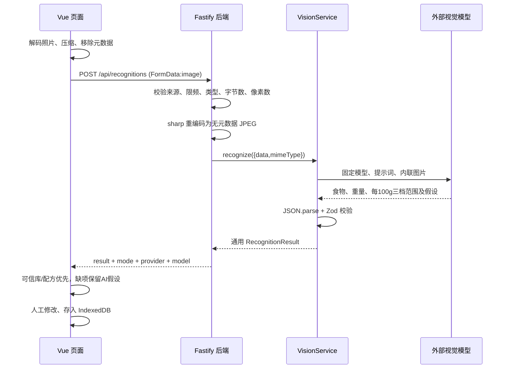

# 食刻 AI 模型调用教学

0.10.0-test新增文字记餐助手，复用模型平台但独立JSON契约：模型只解析描述，营养查本地库，未知重量由代码填参考份量。[完整调用与保存流程](meal-assistant.md)。

0.9.9-test新增DeepSeek官方`deepseek-flash`视觉模型，共六个平台十个选项；显式关闭思考，使用内联图片与JSON Object。[DeepSeek教学](deepseek.md)。

0.9.8-test新增硅基流动与OpenRouter适配器、百炼`qwen3-vl-plus`，共五个平台九个模型。新平台的固定端点、参数、免费类型与操作说明见[免费视觉模型教学](free-vision-models.md)；新增型号尚未真实账号调用。

0.7.0 可在识别面板手动切换已配置模型；网页只得到模型元数据，Android 只读取本机加密配置的元数据，不返回 Key。切换不调用模型，失败不自动改选。AI 允许付费，自建云端入口暂时关闭。条码查询走独立免费的 [Open Food Facts API](open-food-facts.md)，不调用视觉模型。

0.6.0 增加包装分支：同一次视觉请求可输出 `packageLabel` 原标注，包装不要求三档，也不使用同名基础食物替换。模型抄表，代码换算 kJ、每份及实际摄入量；无法读清则留空。原标签与消费快照的完整字段、优先级和实现见 [包装食品教学](packaged-food.md)。下文的每 100 g 三档规则适用于普通餐食。

安卓 0.3.0 新增默认的手机自配 Key，多提供商、多配置可手动切换，无需自建后端；密钥存储、原生 HTTP 和操作教程见 [手机多模型教学](personal-models.md)。以下后端调用流程仍适用于普通网页或“连接食刻服务”模式。

后端连接模式补充：App 从内置页面启动，`lib/connection.ts` 将 HTTPS 服务地址与短期访问令牌留在本机；`lib/api.ts` 将固定 `/api/` 路径拼接到所选来源，只向该服务发送 Bearer 令牌，不跟随重定向。供应商 Key 仍只在后端。照片请求最多等待 70 秒，云端识别 45 秒，额度检查另留时间。云端的访问码、CORS、OSS 原子日限额与实际部署步骤见 [独立手机版部署教学](cloud-deployment.md)。

这份文档配合 `packages/server/src/vision/` 阅读。视觉模型在一次请求中回答名称、可食重量、可见配料、不确定性，以及每 100 g 营养的低、中、高三种范围情景和具体假设。页面优先使用可信数据库或已有配方，仅在缺少可靠匹配时使用明确标注的 AI 粗估，默认采用中档范围的中值，再按重量计算整份营养。照片无法直接测量隐藏的油量，也无法保证重量准确；用户可检查编辑后直接点击“保存记录”，不再要求额外勾选“我已核对”。保存仍保留估算、模拟来源和缺失值，不把点击保存当作营养实测证明。

## 1. 一次识别经历了什么



浏览器不需要供应商 API Key。前端只请求自己的后端：

```ts
const body = new FormData();
body.append('image', compressedFile); // 必须是 image 字段，一次一张照片

const response = await fetch('/api/recognitions', {
  method: 'POST',
  body,
});
// 不要手动设置 Content-Type；浏览器需要自动加上 multipart boundary。
const payload = await response.json();
if (!response.ok) throw new Error(payload.error.message);
```

开发网页使用 `http://127.0.0.1:5180`，Vite 将 `/api` 代理到 3001 端口的 Node 后端，生产构建由 Node 同源提供页面。这也避免为浏览器开放宽松 CORS。

后端收到的数据并不可信。文件扩展名 `.jpg` 或请求头 `image/jpeg` 不能证明文件真的是图片，食刻同时检查文件魔数并尝试解码。服务端图片仅在内存使用；客户端重编码去除 EXIF/GPS 后才发给模型。用户确认保存餐次后，识别用压缩照片会保留在客户端本地 IndexedDB，服务端不存储照片。

## 2. 为什么有独立 Service

所有模型实现相同接口：

```ts
interface VisionService {
  readonly mode: 'live' | 'mock';
  readonly provider: 'gemini' | 'glm' | 'qwen' | 'mock';
  readonly model: string;
  recognize(image: { data: Buffer; mimeType: 'image/jpeg' }): Promise<RecognitionResult>;
}
```

`buildApp()` 只依赖这个接口，供应商差异集中在 `gemini.ts`、`glm.ts` 和 `qwen.ts`。业务页面和营养计算不依赖上游接口格式；新增供应商时，也要同步扩展共享的 provider 白名单、设置页名称和备份校验测试。测试可以注入假的 Service，稳定验证 API 故障而不消耗免费额度。

项目没有接受前端传入的模型名、提示词或上游 URL。这样用户上传文件时就不能把后端当作通用模型代理，也不会意外选到收费模型。

## 3. Gemini 具体如何请求

食刻使用 Node.js 内置 `fetch`，当前固定调用 `gemini-3.5-flash-lite`：

```ts
const response = await fetch(
  'https://generativelanguage.googleapis.com/v1beta/interactions',
  {
    method: 'POST',
    headers: {
      'Content-Type': 'application/json',
      'x-goog-api-key': process.env.GEMINI_API_KEY!,
    },
    body: JSON.stringify({
      model: 'gemini-3.5-flash-lite',
      store: false,
      system_instruction: FOOD_PROMPT,
      input: [
        { type: 'text', text: '请识别照片中的食物。' },
        { type: 'image', mime_type: 'image/jpeg', data: jpeg.toString('base64') },
      ],
      generation_config: { thinking_level: 'minimal', max_output_tokens: 8192 },
      response_format: {
        type: 'text',
        mime_type: 'application/json',
        schema: recognitionJsonSchema,
      },
    }),
    signal: abortController.signal,
  },
);
```

这是教学摘录，生产代码还包含下载超时、HTTP 状态处理和结果校验，不要直接把摘录复制到前端。识别与营养粗估在同一次模型请求中完成，不额外发送第二次营养请求。Base64 是二进制图片的一种文本表示方式，不是加密；真实传输由 HTTPS 保护。

三档会增加输出长度，所以输出上限调整为 8192 tokens，每次最多识别 10 项食物。照片中有更多食物时，模型应在全局不确定提示中说明需要分批，不声称已完整识别所有食物；返回超出 10 项也会被服务端拒绝。

多食物识别要求模型先扫描整张照片的各个碗、餐盘与杯子，再逐项输出可以可靠判断的食物。每项的 `estimatedWeightG` 只对应该项的最终可食重量，不能把整餐重量复制到每个条目，也不能统一填 100 g 或平均分盘。骨、壳、果皮和餐具不计入可食重量；熟饭、熟肉和熟菜按熟重，合理份量线索不足时返回 `null`，不能编造比例尺。混合成一道菜的食材只放入 `visibleIngredients`，不和整道菜重复进入 `foods`。

前端在本地逐项匹配已有食物和参考配方，原重量跟随同一条记录；只去除数量与容器描述来辅助名称匹配，不删除生熟、糖油等区别。匹配不到时继续采用有标识的 AI 估算或保留缺失。具体实现见 [前端教学](frontend-guide.md)。

REST 响应可能在 `steps` 中包含思考、工具活动和最终输出。食刻只读取 `type === 'model_output'` 的文本，不把思考步骤当作 JSON。也兼容便利字段 `output_text`。[Interactions API 参考](https://ai.google.dev/api/interactions-api)

响应中的生成状态也必须正常：Gemini 只接受已提供的 `status:completed`，GLM 只接受已提供的 `finish_reason:stop`。即使被截断或失败的响应碰巧含有语法有效的 JSON，也不能冒充完整识别。

注意 JSON Schema 的兼容边界：本项目实际联调时，上游拒绝了一组完整约束的 Schema，返回 HTTP 400。现在只向 Gemini 发送基础 `type/properties/items/required` 结构和 `additionalProperties`；可空重量用 `type:["number","null"]`。字符串长度、数组数量和数值范围在服务端 Zod 中检查。不要认为某个供应商支持 JSON Schema，就能直接把任意校验库生成的 Schema 传给它。后端对照片的端到端联调必须与模拟单元测试一起验证。

`store:false` 关闭本次可检索 Interaction 的存储，项目也不调用 Files API。它不能证明供应商完全不保留任何数据；服务条款、反滥用处理和免费层数据政策仍独立适用。[存储说明](https://ai.google.dev/gemini-api/docs/interactions-overview)

## 4. 配置密钥和切换模型

在项目根目录 `.env` 配置，重启后端生效：

```dotenv
# Gemini 开发测试
AI_PROVIDER=gemini
AI_MODE=auto
GEMINI_API_KEY=你自己在本机填写的密钥

# 切换国内 GLM 时修改上述 provider，并配置这一项
# AI_PROVIDER=glm
# ZHIPU_API_KEY=你自己在本机填写的智谱密钥

# 切换百炼时修改 provider，使用北京区通用 API Key
# AI_PROVIDER=qwen
# DASHSCOPE_API_KEY=你自己在本机填写的百炼密钥
# QWEN_MODEL=qwen3.7-flash
```

三种模式的含义：

- `auto`：所选供应商有密钥就真实调用，没有密钥就返回明确标记的模拟数据。
- `mock`：无论是否存在密钥，都返回固定演示数据。演示名称与上传照片无关。
- `live`：必须有密钥；缺少密钥时启动失败。适合验证部署配置。

配置 Gemini 密钥却把 `AI_PROVIDER` 改成 `glm` 时，auto 会检查智谱密钥，不会借用 Gemini 密钥。真实调用出现故障不会偷偷切换成模拟结果。

GLM 使用 `https://open.bigmodel.cn/api/paas/v4/chat/completions`、`Authorization: Bearer ...`、白名单 `glm-4.1v-thinking-flash`、`glm-4.6v-flash`、`glm-4.6v-flashx`；图片包装为 `image_url` 的 data URL。4.6V与付费FlashX关闭额外思考，4.1V保留内置思考，按完整think/answer标签读取最终答案。响应须正常结束，再进入同一解析器。首版对 GLM 不假设原生结构化输出一定可用，由提示词约束和本地 Zod 共同把关。[智谱官方模型文档](https://docs.bigmodel.cn/cn/guide/models/free/glm-4.6v-flash)

### 百炼 Qwen 是怎么调用的

`vision/qwen.ts` 使用北京区通用兼容端点 `https://dashscope.aliyuncs.com/compatible-mode/v1/chat/completions`，通过 `Authorization: Bearer ...` 传密钥。固定白名单为 `qwen3.7-flash`、`qwen3.8-flash`、`qwen3.7-plus`，默认第一个；上传页面不能选择其他模型、提示词或 URL。[地域与密钥说明](https://help.aliyun.com/zh/model-studio/get-api-key)

下面是后端请求体的教学摘录，完整超时和错误处理见实际 Service：

```ts
{
  model: 'qwen3.7-flash',
  enable_thinking: false,
  max_tokens: 8192,
  response_format: { type: 'json_object' },
  messages: [
    { role: 'system', content: FOOD_PROMPT },
    { role: 'user', content: [
      { type: 'text', text: '识别照片中的食物，只输出JSON。' },
      { type: 'image_url', image_url: { url: `data:image/jpeg;base64,${jpeg.toString('base64')}` } },
    ] },
  ],
}
```

Base64 图片只随这一次 HTTPS 请求发送，不创建 OSS 对象或供应商文件。没有设置 `tools` 或聊天历史，也不自动重试，从而避免隐含的工具及重复调用。关闭思考能减少额外用量，但不是免费保证。

百炼官方说明视觉输入的 `json_schema` 会降级为 `json_object`，Schema 约束不生效，所以这里明确请求 JSON Object，再用固定提示词和本地 Zod 验证字段、数值和三档假设。Qwen 响应必须有 `finish_reason:'stop'`，只解析 `choices[0].message.content`，不解析 `reasoning_content`。即使 HTTP 200，也可能被截断、字段错误或缺少范围，必须显示失败并保留草稿。[结构化输出边界](https://help.aliyun.com/zh/model-studio/qwen-structured-output)

单元测试的 fake fetch 不收费。需要手动真实对照时运行 `npm run test:vision:live -- --live`；没有 `--live` 会拒绝执行。脚本只发送固定的 Google 公开司康样图和程序生成的非食物图，每个已配置模型最多两次，不读取 `picture/`。它报告 HTTP 状态、结构校验、耗时和 token，脱敏摘要写入已忽略的 `artifacts/vision/model-smoke.json`，不保存原始响应。结构失败也可能消耗额度，超时的用量未知，不能记为零费用。该脚本不能替代有称重真值的准确率评测。

`.env` 已被 Git 忽略，教学和示例文件只允许出现占位符。不能用 `VITE_GEMINI_API_KEY` 或 `VITE_ZHIPU_API_KEY`，因为 Vite 会把 `VITE_` 前缀变量打包进网页。此前旧智谱密钥曾进入本地 Git 历史；现已清理该文件的本地历史、旧恢复记录及敏感 Git 对象，本机配置保留。仅停止跟踪不足以清除旧版本；历史清理也不会让 API Key 失效，仍须在智谱控制台撤销旧密钥并换新。如有旧仓库副本，需要一并处理，避免重新带回敏感历史。[GitHub 官方处理说明](https://docs.github.com/en/authentication/keeping-your-account-and-data-secure/removing-sensitive-data-from-a-repository)

## 5. 提示词与结构校验

通用结果只包含：

```json
{
  "isFood": true,
  "foods": [
    {
      "name": "杂粮粥",
      "estimatedWeightG": 200,
      "visibleIngredients": [],
      "uncertainties": ["重量为照片估算，请按实际份量修改"],
      "estimatedNutrientsPer100g": {
        "energyKcal": 75,
        "proteinG": null,
        "fatG": null,
        "carbsG": null
      },
      "nutritionAssumptions": ["普通甜度参考情景，谷物比例、糖量与含水量未知"],
      "nutritionEstimateProfile": {
        "factor": "sweetness",
        "options": [
          {
            "level": "low",
            "label": "无糖比较稀",
            "rangesPer100g": { "energyKcal": { "min": 40, "max": 60 }, "proteinG": null, "fatG": null, "carbsG": null },
            "assumptions": ["无额外糖、比较稀的参考情景，谷物比例未知"]
          },
          {
            "level": "medium",
            "label": "普通甜度",
            "rangesPer100g": { "energyKcal": { "min": 60, "max": 90 }, "proteinG": null, "fatG": null, "carbsG": null },
            "assumptions": ["普通甜度参考情景，谷物比例、糖量与含水量未知"]
          },
          {
            "level": "high",
            "label": "糖多浓稠",
            "rangesPer100g": { "energyKcal": { "min": 90, "max": 120 }, "proteinG": null, "fatG": null, "carbsG": null },
            "assumptions": ["糖较多或更浓稠的参考情景，实际糖量未知"]
          }
        ]
      }
    }
  ],
  "uncertainties": []
}
```

上例只是结构和参考情景说明，不是真实测量或粥的统一标准。其他粥、配方或干谷物不能机械套用这些区间。`factor` 可以是 `sweetness`（甜度或稀稠）、`oil`（用油）或 `general`（其他配方变化）。`options` 必须正好三项，低、中、高各出现一次，每档都保留自己的假设。

范围和单值始终都是每 100 g。服务端按中档每个范围计算 `(min + max) / 2`，覆盖模型自己提供的单值；上例 `(60+90)/2=75 kcal/100 g`，200 g 的默认估算是 150 kcal，中档对应整份 120–180 kcal。未知宏量保留 `null`，不能为了凑热量倒推出貌似精确的蛋白质、脂肪和碳水。

这些区间描述不同糖、油、含水量或配方假设，不是统计置信区间，不保证覆盖真实数值。三档热量范围按低到高排列，可以重叠或相同；水、纯黑咖啡等不能为了三个按钮而凭空制造差异，允许 `min=max` 的退化范围。用户选择低档或高档后按对应中值计算，也可以手动填写自己确认的营养数值覆盖粗估。没有依据粗估时 profile 与单值均为空。没有足够依据估计重量时重量为空，不能计算整份热量。

非食物返回 `isFood:false` 和空 `foods`。无法判断食物名称时仍然拒绝猜测；允许营养假设不等于可以编造种类。混合菜、隐藏配料、油、糖和酱汁要写入不确定提示。给出营养粗估时必须说明实际假设，例如“按无糖清水稀粥、含水量未知”或“每 100 g 菜假设摄入 5 g 油”，不能只写“仅供参考”，不能虚构来源或标签。

“要求模型返回 JSON”并不足以让 JSON 可信，所以代码执行两层检查：先 `JSON.parse()` 验证语法，再 `recognitionResultSchema.safeParse()` 验证类型、范围和多余字段。食刻只去掉完整外围 Markdown 围栏，不从一大段回答里猜测截取 JSON，不补造缺失字段，绝不使用 `eval()`。

营养只能放在指定的三档范围和兼容单值对象，放在顶层或混入额外字段仍会被拒绝。本地检查 `min<=max`、每 100 g 热量不超过 1000 kcal、每种宏量不超过 100 g，拒绝负数及非有限数值；重复档位、缺少任一档、任一档无非空假设都会被拒绝。这些校验只检查格式和基本合理性，不能保证营养正确。

旧响应可以只有合法单值而没有 profile，便于兼容历史数据。新的 Gemini 和 GLM 请求启用 `requireProfile:true`：既然模型给出了可用热量，就必须同时返回三档范围；不能借旧数据兼容逻辑省掉新范围。热量确实无法估计时仍允许 `null`。

前端匹配可信基础食物或参考配方后采用其数据，不让 AI 覆盖数据库数值。缺少可靠匹配的食物显示“AI 粗估”，记录供应商、模型、假设和数值快照。用户可以修改数值或选择更可靠来源；没有任何依据时保持待补充，不能把未知变成零。个人估算数据仅留在当前浏览器，不混进 USDA 公共库；模拟条目不加入真实个人估算库。

## 6. 免费额度、隐私与真实测试边界

模型支持免费层不等于每个 API Key 都会免费。必须到 AI Studio 确认项目处于 Free Tier、该模型的当前配额和计费设置。免费层及地区政策可能变化，食刻的请求限额也不是供应商账单控制。[Gemini 价格](https://ai.google.dev/gemini-api/docs/pricing) · [可用地区](https://ai.google.dev/gemini-api/docs/available-regions) · [API 条款](https://ai.google.dev/gemini-api/terms)

开发前的会话中已有三次 Gemini 请求返回 HTTP 200：一张数字测试图、一张非食物图和一张公开餐食图。这只能说明当时链路可用、结构可以解析，不能证明食物分类或份量准确。GLM 两次请求返回 429 / 1305，同样不能证明模型永久不可用。

加入营养粗估后，另用 Google 的公开 `scones.jpg` 样图进行一次 Gemini 实测，HTTP 200 并通过新字段校验。模型返回的司康、蓝莓、咖啡名称、重量、营养及含奶假设未经称重或人工标注核实，只证明新请求格式可用。[公开示例图](https://storage.googleapis.com/generativeai-downloads/images/scones.jpg)

加入三档范围后，该公开图首次 HTTP 200 响应存在“有单值热量但没有 profile”的情况，已被后端拒绝。加强完整三档示例和用户指令后的第二次请求 HTTP 200，四项食物均带三档；服务端还纠正了两项单值与中档中值不一致的模型算术。这说明仅有有效 JSON 不够，仍需语义校验与实际联调，不代表区间已得到称重真值验证。

免费 Gemini 服务可能使用内容改进产品。上传前避免拍到人脸、住址、票据或其他个人信息；食刻页面会提示这个真实限制。换到国内模型后也要重新阅读其数据条款，不能把更换服务商等同于不再传出照片。

验证识别效果应拿同一批真实餐食分别拍照、称重并人工标注，对照漏检、误判和重量误差。没有称重真值的样图不要用来宣称准确率。

2026-10-15 加强多食物与逐项估重提示词后，使用已缓存的同一张公开 `scones.jpg` 做了一次 Gemini 真实调用，约 9.6 秒返回四项并通过校验：蓝莓司康 360 g、新鲜蓝莓 90 g、黑咖啡 120 g、拿铁咖啡 130 g。其中三项名称可匹配本地基础食物／参考配方，司康使用 AI 粗估。以上重量均为模型估计，缺少称重真值；这里只验证多项输出、独立重量和匹配链路，不证明份量准确或照片中的饮品配方确实如此。没有读取或发送项目 `picture` 目录中的私人照片。

## 7. 错误如何诊断

- `AI_UNAUTHORIZED`：检查所选供应商密钥是否正确、是否已经重启后端。不要把密钥发到聊天或日志。
- `AI_FORBIDDEN`：检查可用地区、项目权限和服务是否开通。它不会自动改用另一个供应商。
- `AI_RATE_LIMITED`：上游 429，可能是免费额度用尽或模型繁忙。页面保留草稿；按 `Retry-After` 稍后重试。
- `REQUEST_RATE_LIMITED`：本地每 IP 分钟限制，默认 5 次。
- `DAILY_LIMIT_REACHED`：本地进程今日全局次数达到默认 100 次，按北京时间（Asia/Shanghai）午夜重置。
- `AI_BUSY`：默认单并发，已有照片在识别。稍等再试，不排无限队列。
- `AI_TIMEOUT`：45 秒内没有完成，包括响应下载。可以手动记录。
- `AI_NETWORK_ERROR`：后端无法连接模型服务，检查后端网络，前端能打开并不代表模型能访问。
- `AI_INVALID_JSON` / `AI_INVALID_RESULT`：模型没有遵守结构约定。重新识别或手动记录，不能直接保存未经校验的原始内容。
- `IMAGE_TYPE_INVALID` / `IMAGE_DECODE_FAILED`：文件伪装、损坏、动画或像素过大；转换成单张 JPEG 后上传。

限额设置为 `AI_REQUESTS_PER_MINUTE`、`AI_REQUESTS_PER_DAY`、`AI_CONCURRENCY`、`AI_TIMEOUT_MS`。首版限额存放在单个 Node 进程内存，重启会重置，多实例也不会共享计数。公网使用前必须加入持久化全局额度与共享访问保护，才能控制朋友之间的总体请求。

## 8. 如何接入下一家模型

1. 新建供应商适配器，实现 `VisionService`，固定允许的模型和 HTTPS 地址。
2. 根据官方文档包装图片、认证和提示词，使用统一 `postJson()` 超时及安全错误处理。
3. 提取最终输出文本，调用 `parseRecognition(text, { requireProfile: true })`；只使用统一的每 100 g 三档范围和假设字段，不新增供应商专属营养格式。
4. 扩展 `AI_PROVIDER` 白名单和 `createVisionService()`，在服务端读取新的环境密钥。
5. 增加适配器测试，覆盖成功、非食物、无效 JSON、429、鉴权失败与超时，再进行少量真实对照测试。

不要根据用户输入拼接上游地址、调用收费候选或悄悄回退模式。扩展时保留 `mode/provider/model`，页面才能告诉使用者结果从哪里来。

## 9. 阅读和调试顺序

从 `app.ts` 的 POST 路由开始，看 `image.ts` 的图片处理，再看 `vision/index.ts` 的工厂，最后看所选适配器和 `parse.ts`。必要测试在 `app.test.ts` 与 `vision/vision.test.ts`，使用 fake fetch，运行不消耗模型额度。

可以先把 `AI_MODE=mock` 跑通完整记录流程，再配置真实密钥观察健康接口的 `mode:'live'`。真实请求排错只查看安全错误码、HTTP 状态和耗时，不能打印整个请求头、图片 Base64 或模型原始回答。
