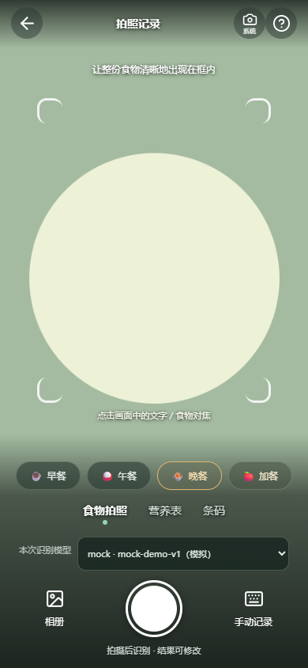

# 0.8.0 拍摄流程：使用方法与实现

0.11.2更新：取景画面铺满应用窗口，餐次、模式、模型与快门浮在画面上，横屏移到右侧；右上角「系统」图标可切换系统相机。布局实现见`packages/web/src/camera-fullscreen.css`，原生及裁切规则见[相机说明](native-camera.md)。

当前安卓0.9.1-test已经改用原生CameraX预览与静态拍照，支持点按对焦；网页仍使用本页的getUserMedia流程。OPPO Find X9问题、调用路径及真机复测方法见[原生相机教学](native-camera.md)。以下0.8.0说明保留为网页实现与历史记录。

## 手机怎么用

1. 在饮食页点击「拍照识别」或底部相机，直接打开全屏取景页。首次使用允许相机权限。
2. 在画面下方选择早餐、午餐、晚餐或加餐，选择「食物拍照」「营养表」或「条码」。
3. 食物模式拍全餐盘；营养表模式拍清单位和数字。点击白色快门后压缩图片，再交给所选模型识别；相册也可选择已有照片。模型可以在快门上方切换。
4. 识别后进入编辑，照片缩略图可以点击查看大图，核对每项名称、重量和营养再保存。营养表模式没有可靠标签时会明确报错，不把普通食物估算冒充包装标签。净含量不会自动计作摄入量。
5. 条码模式点击快门或选图后在设备本地读码，自动查询本机包装库，未命中再查免费 Open Food Facts。也可点「输入条码」。此模式不上传条码照片给AI。

右上角问号提供拍摄说明及实际采集尺寸，设备支持时启用连续自动对焦；存在多个摄像头时可切换。取景铺满可用区域，不拉伸图像。设备报告支持连续补光时才显示补光灯。辅助框是构图提示。照片按屏幕可见范围中心裁切，与取景保持一致，拍照前应让所需食物和完整营养字段留在画面内。相机权限被拒绝、没有相机或相机被占用时，会显示具体提示，并保留系统相机与相册入口。

取景页进入后台时停止视频轨道，回来后点击「继续拍摄」。退出取景页也关闭轨道，不在后台继续采集。拍摄时照片仅在内存处理；确认保存餐次后，经压缩、去除 EXIF/GPS 的照片保存在本机独立表中，可从餐次缩略图查看并放大，也随 v11 备份导出。不会自动写入系统相册。旧记录未保存的照片无法补回。

APK内的页面和食物库已经内置，电脑可关闭。AI识别和首次查询OFF仍需要手机联网；配置入口为设置中的手机自配Key。网页通过局域网HTTP访问时，浏览器可能禁止实时相机，此时使用系统相机或相册；APK使用本地HTTPS来源，不依赖电脑IP。

## 代码如何连接

- [CaptureCamera.vue](../packages/web/src/components/CaptureCamera.vue)：`getUserMedia({ audio: false, video: { facingMode: { ideal: 'environment' }, ... } })`请求后摄视频；不请求麦克风。`<video playsinline muted>`显示实时画面。
- 快门使用`cameraCrop()`计算与CSS cover相同的可见区域，再用`canvas.drawImage(video, ...)`截取一帧，最长边限制1920px，转换为内存JPEG `File`。食物／营养表交给编辑器，编辑器原有`compressImage()`再按上传限制压缩。
- [App.vue](../packages/web/src/App.vue)的手机入口先打开相机。`capture(file, kind, mealType)`创建编辑草稿并传入照片；编辑器内部「拍照」也复用同一取景组件。
- [FoodEditor.vue](../packages/web/src/components/FoodEditor.vue)的`processFile()`压缩图片，`runRecognition()`调用独立AI服务。`photoKind`只控制标签结果检查，用户不能借此指定上游URL或任意提示词。具体模型请求见[个人模型调用教学](personal-models.md)和[AI模型教学](ai-models.md)。
- 条码事件先使用[barcode.ts](../packages/web/src/lib/barcode.ts)的ZXing本地解码，得到数字后打开[PackagedLibrary.vue](../packages/web/src/components/PackagedLibrary.vue)，查询过程见[OFF API教学](open-food-facts.md)。没有读清条码时停留取景页并提示重拍／输入。
- Android Manifest新增`CAMERA`权限，摄像硬件标记`required=false`，没有摄像头仍可安装并手动记录。Capacitor Android现有`BridgeWebChromeClient.onPermissionRequest()`将WebView的视频请求转为Android运行时权限请求；应用不申请麦克风、广泛存储或后台相机权限。
- [camera.ts](../packages/web/src/lib/camera.ts)只在`getCapabilities().focusMode`包含`continuous`时申请连续对焦；失败保留普通取景。高清请求是ideal，实际分辨率以视频元数据为准，不把提高请求值宣传成真实相机画质提升。相关能力来自[W3C MediaStream Image Capture](https://www.w3.org/TR/image-capture/)。
- `generation`标记使已经关闭的异步相机请求返回后立即停止轨道，避免用户先退出再允许权限时遗留相机。隐藏页面、退出和卸载组件均调用`track.stop()`。

## 食物、包装食品和饮品

手动添加内的「选择食物」使用与编辑器相同的分类／搜索弹窗，包含「包装食品」。这里展示已保存的标签，可按名称、品牌或条码搜索；「查包装食品／条码」可查询公开商品，再明确保存到包装库。不会把整个OFF数据库下载到手机，也不把未收录商品猜成另一款商品。

普通饮品可以选择mL，填写每100mL营养与本次饮用量。切换g／mL会清空原份量和营养，禁止把200g当200mL。只有每100g资料时，仍可按称重记录，不能无密度换算为体积。包装饮料直接使用包装明确的100mL、每份或每包基准。

普通饮品使用`volumeSnapshot`保存容量及当时每100mL营养，不混入`weightG`或`nutrientsPer100g`。备份版本升级v6，兼容v1～v5；历史不因食物库更新重算。单位输入和展示最多两位小数，内部计算保留精度。

## 验证范围

241项单元／接口测试与生产构建通过；Chrome手机视口、Chrome桌面和Edge桌面的15项相机场景通过，新增大图入口另专项复测3项。真实LAN HTTP下24项相机回退／手动食物场景通过，6项实时视频场景因浏览器安全来源限制跳过。实际运行中的5180开发页已验证390px宽手机取景区为390×550px，使用cover填充，不拉伸，实际开发页没有触发AI请求。

自动化使用合成图像与视频流，覆盖取景、餐次传递、拍照识别编辑保存、营养表成功／失败、条码本地读码、权限拒绝回退和关闭轨道。Chrome手机视口、桌面Chrome／Edge及非安全LAN HTTP分别验证；这不等于真机验证。Android摄像头方向、权限弹窗、补光、软键盘及系统相机返回仍需安装APK实测。

