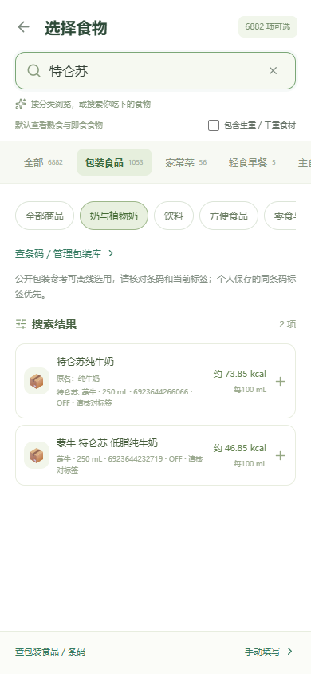

# 运动项目与内置包装食品

本页记录首次包装扩库。0.9.3已补充中文名称并复核2条无法确认食品身份的商品，当前为1,053款，详见[中文化更新](food-localization.md)。

当前包装库已扩充至 1,055 款，网页与 0.9.0-test 独立 APK 使用同一份离线数据。数据取得与程序校验日期：2026-10-16；未逐件核对实物。

## 怎么使用

**运动**：饮食首页 → 运动卡片「添加」→ 按项目估算 → 选择项目、填写体重和分钟数。列表从 6 项扩充为 32 项，按步行与跑步、骑行、健身与力量、球类与跳绳、游泳分组。包括跳绳、羽毛球、乒乓球、篮球、足球、网球、蛙泳、自由泳、仰泳、瑜伽、普拉提、椭圆机和力量训练。俯卧撑仍按个数记录，也可通过「额外活动」旁的加号快捷添加。

**包装食品**：饮食记录「手动添加」→「选择食物」→「包装食品」。内置 1,055 款 Open Food Facts（OFF）商品参考，分为奶与植物奶、饮料、方便食品、零食与坚果、谷物与蛋白粉、面包与糕点、肉蛋与即食、冷冻与罐头、调味品、其他包装，共 10 类。支持中文名、原商品名、品牌、别名和条码搜索，也能筛选子分类。例如搜索「特仑苏」「东方树叶」「康师傅」「乐事」或对应条码。列表每次显示60项，可以继续加载。

选择之后填写这次实际吃／喝了多少；未默认吃完整包。饮料保留每 100 mL 基准，固体按 g；不能把 mL 直接当 g。缺失净含量时不会显示假定的整包换算，仍可按标签明确的单位填实际摄入量。



**条码查找和个人库**：在食物选择器点「查条码／管理包装库」，或设置 → 包装食品库。查找依次使用个人保存标签、内置参考，均未命中才联网查询 OFF。内置参考可离线浏览和按条码选择；查看商品后可选择「加入这一餐」或显式「保存到包装库」。同条码个人标签优先显示，避免重复。

内置商品不会自动写入 IndexedDB；备份只包含你保存的个人商品及实际餐食。每餐保存独立标签快照，修改参考或个人标签不会重算旧餐食。不同条码代表的规格或配方不按热量接近规则合并。

## 运动热量如何计算

参考 [2024 Adult Compendium](https://pacompendium.com/) 的项目编号和原始 MET：

- [步行](https://pacompendium.com/walking/)、[跑步](https://pacompendium.com/running/)、[骑行](https://pacompendium.com/bicycling/)。
- [健身与力量](https://pacompendium.com/conditioning-exercise/)、[球类／跳绳等运动](https://pacompendium.com/sports/)、[游泳](https://pacompendium.com/water-activities/)。

沿用项目现有公式 `活动能量 = (MET - 1) × 体重 kg × 分钟 ÷ 60`，减去同段静息部分。每项强度写在名称中，不把不同泳姿或配速当成同一强度。例如蛙泳休闲为 MET 5.3，70 kg、30 分钟估算活动能量 150.5 kcal。结果是参考估算，个体实际值仍有差异；显示最多两位小数，计算快照保留原精度。

原有 6 项编号和 MET 没有变，旧备份仍可恢复。手环全天汇总、普通运动覆盖和俯卧撑独立额外活动的合计方式沿用 [手环教学](../packages/shared/src/wellness.ts) 和 [俯卧撑教学](../packages/web/src/components/PushupQuickEntry.vue)，本轮不重复增加预算。

## 包装数据从哪里来，能相信到什么程度

数据来自 [OFF 官方只读 API](https://openfoodfacts.github.io/openfoodfacts-server/api/) 与 [Search-a-licious 搜索 API](https://openfoodfacts.github.io/search-a-licious/users/ref-openapi/)，无需 API Key。本次从 7,948 条去重公开搜索结果中筛选，保留原33项并新增1,022项，总共1,055款。搜索条件为中国销售地区标签，以及69开头的条码；两者都不能证明国产或国内现售。包含中国品牌、出口商品和进口商品，不能据此估计国内商品覆盖率。原始入选 JSON、逐商品取得时间、条码、搜索响应校验值、来源链接和排除原因统计都随项目提供。

当前249项展示名含中文，其余保留原文名称；中文品牌前缀和别名只辅助搜索，不改营养数字，也不把母公司旗下其他品牌强行改名。能判断的商品按原类别或名称整理，无法确认的归入「其他包装」。不是1,055种中国食品，也不是逐项实物验证后的营养数据库。

这是社区参考，未逐件核对实物标签；配方、规格和标签会变化。选取时剔除了发现能量单位冲突或计量明显不一致的条目，没有凭空修正这些数值。保留入选条目的原始 kcal／kJ、三大营养素、份量和缺失值。kJ 只在计算时除以 4.184；无法确定的净含量留空。应优先使用你手中同条码包装上的营养表，核对后可修正并保存个人标签。

OFF 数据库使用 ODbL，单项内容适用 DbCL；它与 USDA 数据及代码分开放置。这里没有下载商品图片。再分发本子集请保留来源、许可和可取得的数据文件，详见 [包装数据许可声明](../packages/shared/data/PACKAGED-FOODS-LICENSE.md)。

## 开发者如何维护

- `packages/shared/src/exercise-catalog.ts`：运动项目、强度、分组和官方来源。新增项目时核对原始编号；不要修改已用编号的 MET，否则旧记录快照校验会受影响。
- `packages/shared/data/packaged-catalog-selection.json`：入选条码、中文展示名、类别和搜索别名。
- `packages/shared/data/packaged-catalog-source.json`：可再分发的入选原始 OFF 商品 JSON 和取得元信息。
- `packages/shared/data/packaged-catalog-import-report.json`：总量、类别、排除原因与条码清单。
- `scripts/fetch-packaged-catalog.mjs`：开发者显式下载公开搜索数据，串行、至少7秒一次，失败停止并保留断点缓存；正常启动和构建不会联网抓库。
- `scripts/expand-packaged-catalog.mjs` 与 `scripts/lib/packaged-import.mjs`：检查明确的质量／体积基准、能量单位及宽松营养一致性，补充品牌别名和分类；不以宏量营养素反算或补造热量。酒精、糖醇等可能被保守排除。
- `scripts/import-packaged-catalog.mjs`：从已取得的公开 JSON 生成参考，不在构建或测试时抓取网络。它使用统一 OFF 解析器、Zod 校验，并拒绝明显 kcal/kJ 冲突、缺少能量或缺少明确基准的条目。
- `packages/shared/src/packaged-catalog.generated.ts`：生成结果，不手改营养数字。
- `packages/shared/src/packaged-catalog.ts`：只读参考与个人标签合并，同条码个人标签优先。
- `FoodPicker.vue` / `PackagedLibrary.vue`：统一选择器、分类、搜索、离线查码及显式保存入口。

重新生成当前快照，无需联网：

```powershell
npm run build -w @shike/shared
node scripts/import-packaged-catalog.mjs packages/shared/data/packaged-catalog-source.json
npm run build
npm test
node scripts/test-e2e.mjs catalog-expansion.spec.ts
```

需要联网更新时单独运行以下命令；下载缓存位于忽略的 `.data-cache/off-expansion/`。先备份工作中的数据文件，再核对导入报告。脚本不会读取.env或调用AI。

```powershell
node scripts/fetch-packaged-catalog.mjs
node scripts/expand-packaged-catalog.mjs .data-cache/off-expansion/collected.json
node scripts/import-packaged-catalog.mjs packages/shared/data/packaged-catalog-source.json
```

不要把同类商品营养数值填到不存在的条码上。运行时在线查询流程详见 [Open Food Facts 调用教学](open-food-facts.md)。APK构建与覆盖安装见[安卓教学](android-app.md)。

## 本轮验证

新增测试覆盖：1,055 项来源与原值一致、g/mL 分离、异常筛选、品牌检索、分页、未填摄入量保持未知、历史快照独立、同条码个人标签优先、旧运动强度不变、新运动估算与恢复校验，以及浏览器中的分类选用、离线查码、保存、刷新和导出。浏览器测试使用隔离数据，不消耗 AI 模型额度。

2026-10-16实际执行通过：268项单元／接口测试、包含类型检查的生产构建、30项Chrome手机视口／桌面和Edge回归；分类调整后另通过12项专项复测。实际开发页在320／390 px下无横向溢出、页面异常或AI请求。1,055项数据可从随仓原始JSON离线逐字节一致地再生成。

独立APK为0.9.0-test（versionCode 10），文件4,946,669字节，位于`artifacts/android/shike.apk`。安卓构建与签名验证通过；解包真实APK资源并断网运行，确认1,055款商品分页选用、250 mL牛奶保存刷新、32项运动和手机模型设置可用，不依赖电脑服务。下载文件与本地APK的SHA-256一致，校验结果记录在`artifacts/android/packaged-expansion-verification.json`。2026-10-19复核APK校验值未变化。手机视口及APK资源的离线自动化检查使用桌面浏览器，不代表已经完成真机验收。
