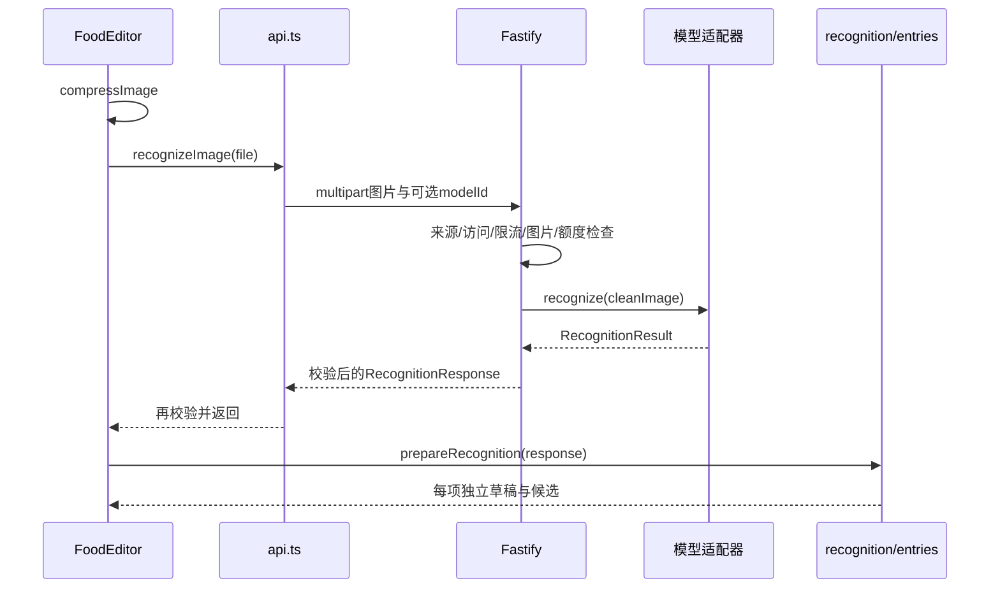

# 食刻源码学习指南

这份指南按当前工作区源码整理。先理解分层，再沿一次操作打开对应文件；代码旁的中文注释解释设计原因，测试提供可执行案例。旧更新记录中的测试数量、食品数量和备份版本只描述当时版本，不能当作当前状态。

## 1. 项目结构与分工

食刻是中文饮食记录应用：支持拍照识别、文字记餐、手动选食物、体重、饮水和运动。确认后的记录保存在设备的 IndexedDB。网页由 Node 服务调用模型；独立安卓 APK 还可通过原生插件保存用户 Key 并直接请求模型。离线记餐与联网 AI 是两种能力。

```text
食刻/
├─ packages/
│  ├─ web/                       Vue 前端 + Capacitor 安卓工程
│  │  ├─ src/main.ts             浏览器入口
│  │  ├─ src/App.vue             页面切换、装载数据、协调保存
│  │  ├─ src/views/              饮食、体重、目标、设置四页
│  │  ├─ src/components/         编辑器、食品库、相机、通用弹窗
│  │  ├─ src/lib/                网络、存储、条目转换、原生桥接
│  │  ├─ tests/                  前端函数、组件与存储测试
│  │  ├─ android/                Java 插件、Manifest、Gradle、资源
│  │  ├─ public/                 图标、许可原文、连接错误页面
│  │  └─ vite.config.ts          编译、开发代理和构建输出
│  ├─ server/src/
│  │  ├─ index.ts                加载配置后启动 HTTP 服务
│  │  ├─ app.ts                  路由、请求处理与依赖装配
│  │  ├─ vision/                 各视觉模型适配器
│  │  ├─ meal-assistant.ts       文字记餐上游调用
│  │  ├─ image.ts                上传验证与重编码
│  │  ├─ auth.ts                 访问凭证
│  │  ├─ quota.ts                共享日额度
│  │  └─ limiter.ts              进程内限频与并发
│  └─ shared/
│     ├─ src/schemas.ts         数据契约及备份迁移
│     ├─ src/nutrition.ts       营养计算与条目快照工厂
│     ├─ src/wellness.ts        预算、体重选择、运动和手环差额
│     ├─ src/*.generated.ts    脚本生成的食品与译名数据
│     ├─ data/                 来源、筛选清单、报告、许可
│     ├─ scripts/              USDA/FNDDS 数据提取
│     └─ tests/                共享业务规则测试
├─ scripts/                    启动、局域网、数据导入、APK、测试脚本
├─ tests/e2e/                  Playwright 实际浏览器流程
├─ deploy/fc/                  保留的函数计算部署配置
├─ docs/                       需要独立阅读的重要说明
├─ package.json                npm workspaces 和根命令
└─ .env.example                服务端配置示例
```

`dist/`、`dist-android/` 和 `artifacts/` 是构建或验证产物，编辑时回到源码。依赖方向是 `web → shared`、`server → shared`；共享层不依赖页面或服务器。

当前没有 Vue Router、Pinia、服务端餐食 SQL 数据库或跨设备自动同步。主页面由 `App.vue` 的 `tab` 切换；Node 负责模型接口，不保存用户餐食。理解这些实际边界，比仅凭技术名称猜架构更可靠。

## 2. 技术分别解决什么问题

- **npm workspaces**：根目录管理三个本地包，通过 `@shike/shared` 引用共同逻辑。构建顺序为 shared、server、web，使后两者可以读取共享包输出。
- **TypeScript**：开发时检查类型。配置见 [tsconfig.base.json](../tsconfig.base.json)，`strict` 与 `noUncheckedIndexedAccess` 要求显式处理缺失值。Node 最终执行的是编译后的 JavaScript。
- **Vue 3 单文件组件**：`.vue` 的 `<script setup lang="ts">` 写状态和事件，`<template>` 写界面，`<style scoped>` 写局部样式。`ref` 存变化值，`computed` 推导结果，`watch` 响应外部变化；脚本通常用 `.value`，模板自动解包。
- **Vite + Tailwind CSS**：编译 Vue、开发热更新、生产打包和样式处理。项目还大量使用 [style.css](../packages/web/src/style.css) 与组件局部 CSS；图标来自 `@lucide/vue`。
- **Fastify**：组织 HTTP 路由与钩子，插件处理 multipart、安全响应头和静态资源。`buildApp()` 返回实例而不直接监听，便于测试。
- **Zod**：运行时检查真正收到的 JSON。`z.infer<typeof schema>` 从校验器推导 TS 类型，避免维护两套结构；TS 本身不能保证模型或备份的实际内容正确。
- **Dexie + IndexedDB**：本地结构化数据、主键索引和跨表事务。部分连接偏好用 localStorage；它与业务记录数据库用途不同。
- **浏览器图像 API / Sharp**：前端解码压缩减少上传，服务端独立验证与清洗。HTTP 调用者可以绕过页面，因此不能删除服务端检查。
- **Capacitor + Java + Gradle**：复用 Web 页面打包 Android，JS 桥调用原生能力，Java 处理相机、Key 加密及 HTTPS，Gradle 构建安卓工程。
- **ZXing**：本机解码条码图片，再查询条码数字；读码不等于将整张照片交给 AI。
- **Vitest / Vue Test Utils / fake-indexeddb / happy-dom**：验证纯函数、组件和本地事务。模拟环境无法代表所有浏览器及设备行为。
- **Playwright**：实际操作浏览器中的选择、保存、刷新、焦点与返回流程。手机视口模拟不能代替真机相机、软键盘或系统分享验收。

安装版本以三个 `package.json` 与根 `package-lock.json` 为准；这里解释项目用法，不判断外部软件最新版本。

## 3. 从启动追到第一屏

依次打开 [main.ts](../packages/web/src/main.ts)、[App.vue](../packages/web/src/App.vue)、[db.ts](../packages/web/src/lib/db.ts)、[DiaryView.vue](../packages/web/src/views/DiaryView.vue)。入口是：

```ts
createApp(App).mount('#app')
```

`App.vue` 用 ref 保存 meals、weights、settings 等当前界面数据。挂载时先 `refresh()`，通过 `loadData()` 读 IndexedDB；读完本地数据再异步 `checkHealth()`，打开已有记录不必等待联网。

模板通过 props 向下传数据，例如 `:meals="meals"`；编辑器通过事件上报保存意图，例如 `@save="persist"`。父层 persist 调用 saveMeal，事务成功后 refresh 并关闭编辑器。响应式数据变化会更新界面，但改一个 ref 不会自动写数据库。

只有目标页使用 KeepAlive 暂存切页时的实例。应用还有滚动位置与页面访问栈，它们均属会话内状态，不保证刷新后恢复。

## 4. 一张照片的完整调用链

按顺序打开这些入口：

1. [CaptureCamera.vue](../packages/web/src/components/CaptureCamera.vue)：取景、系统相机、相册和条码。
2. [FoodEditor.vue](../packages/web/src/components/FoodEditor.vue)：processFile、runRecognition 与编辑状态。
3. [web/lib/image.ts](../packages/web/src/lib/image.ts)：前端解码与压缩。
4. [api.ts](../packages/web/src/lib/api.ts)：recognizeImage 选择路由。
5. [server/app.ts](../packages/server/src/app.ts)：POST /api/recognitions。
6. [server/image.ts](../packages/server/src/image.ts)、[vision/index.ts](../packages/server/src/vision/index.ts)：清洗与模型适配器工厂。
7. [recognition.ts](../packages/web/src/lib/recognition.ts)：prepareRecognition 转换响应。
8. [entries.ts](../packages/web/src/lib/entries.ts)：matchedEntry 选择计算依据。



图是网页服务路由。安卓 `aiRoute() === 'direct'` 时，api.ts 改调 [personal-vision.ts](../packages/web/src/lib/personal-vision.ts) 的 Java 插件，不经过 Node；结果仍回到共同编辑流程。

上传使用 FormData：

```ts
const form = new FormData()
form.append('image', file)
```

浏览器生成 multipart boundary，不能手动设置 Content-Type。客户端用 AbortController 限时，服务端上游也有限时；都需要 finally 清理定时器或并发令牌。

前端压缩目标为最长边1280px、文件不超过1MB；服务端另限上传2MB、解码1000万像素，核对签名和MIME，拒绝动画后重编码。两个限制属于不同阶段。照片压缩后由用户确认保存餐次，进入独立 mealPhotos 表和 v11 JSON 备份；服务端仍仅在内存处理图片。

prepareRecognition 对 foods 做 map：每项保留自己的估重，不能平均整盘重量，也不能把一道菜的可见配料再次记成摄入。包装标签优先；普通条目在 matchedEntry 中先配方，再基础库，再同名个人估算和本次AI候选。旧个人单值没有有效热量三档时，本次有效三档可以优先。

低层 matchedEntry 保留未知重量；当前入口随后用 [applyTypicalPortion()](../packages/web/src/lib/typical-portions.ts) 为首次缺失份量补带提示的大小假设。已知值、明确0和历史加载不被覆盖。旧文档中“完全不预填”描述的是更早版本，不能直接套用到当前入口。

## 5. 模型为什么可以替换

[vision/types.ts](../packages/server/src/vision/types.ts) 定义统一方法：

```ts
recognize(image: VisionImage): Promise<RecognitionResult>;
```

createVisionService 根据配置创建 Gemini、GLM、Qwen 或兼容接口实现。每个实现处理自身鉴权、请求与响应提取，共同输出遵守 [schemas.ts](../packages/shared/src/schemas.ts)。提示词和解析还供安卓复用。

这是适配器模式：供应商协议会变化，业务契约保持统一。`buildApp({ service, fetchImpl, now, dailyQuota })` 支持依赖注入，测试用替身模拟上游错误、超时或额度耗尽，不必调用真实模型。

AI_MODE=mock 强制模拟；auto 在缺少所选Key时模拟；live 缺Key拒绝启动。真实调用失败直接报错，不自动回退成模拟成功。health成功只说明服务运行与配置，不能证明上游可用或估算准确。

配置与操作分别保留在 [AI调用](ai-models.md)、[手机自配模型](personal-models.md)、[云端部署](cloud-deployment.md)。它们包含跨文件操作和安全边界，适合独立文档。

## 6. 数据结构、计算与快照

先读 schemas.ts 的 nutrientsSchema、foodEntrySchema、mealRecordSchema，再读 [nutrition.ts](../packages/shared/src/nutrition.ts)。一餐 MealRecord 含多条 FoodEntry，每条携带名称、份量、来源与营养快照。

```ts
export type Nutrients = z.infer<typeof nutrientsSchema>;
```

这个类型从运行时schema推导，避免另写一份可能不同步的接口。null表示不知道，0表示明确为零。普通质量数据用每100g×重量/100，volumeSnapshot用每100mL，包装标签交 [package-label.ts](../packages/shared/src/package-label.ts)。不能将mL当g，整包净含量也不等于吃完的量。

下面是可运行的共享层示例，数值为教学输入，不对应具体食品：

```ts
import { calculateNutrients, createId, type FoodEntry } from '@shike/shared'

const entry: FoodEntry = {
  id: createId(), name: '教学样例', weightG: 150,
  nutrientsPer100g: { energyKcal: 100, proteinG: null, fatG: 0, carbsG: 20 },
  provenance: '教学输入', kind: 'manual', warnings: [],
}
const result = calculateNutrients(entry)
// energyKcal=150，proteinG=null，fatG=0，carbsG=30
```

aggregateNutrients 分开累计各营养的 known 和 missing，能显示已知部分而不把未知当0。明确摄入量为0时按零摄入处理。

AI三档保存每100g范围，默认普通档，各字段取(min+max)/2记账。假设60～90kcal/100g、300g，整份180～270、中值225。这是做法情景，不是统计置信区间。手填确定值撤销不再适用的估算；配方油档替换原油量，不能双计。

createFoodEntry、createRecipeEntry、createEstimatedFoodEntry 生成独立快照。库更新、删个人食品、修改另一餐都不应静默重算历史。显示最多两位小数，内部不反复截断；对照 [dates.ts](../packages/web/src/lib/dates.ts) 的格式化函数。

## 7. 编辑草稿怎样提交数据库

FoodEditor.submit 发save事件，App.persist 等待 db.saveMeal。保存先转普通JSON并Zod校验，再进入跨表事务：

```ts
await database.transaction('rw', [database.meals, database.estimatedFoods,
  database.preferences, database.weights, database.dailyPlans], async () => {
  // 餐食、符合条件的个人估算、当日计划一起提交。
})
```

这是事务骨架，完整逻辑在 [saveMeal()](../packages/web/src/lib/db.ts)。任一写失败整体回滚，界面保留草稿。plain转换是为了剥离Vue Proxy；领域对象只含JSON数据，这不是适用于任意JS对象的深拷贝工具。

要区分三个个人库：

- estimatedFoods：保存真实餐食时，实际采用的有效AI粗估按规范名称更新，供未来同名匹配；始终标为估算。
- libraryFoods：用户明确存库的完整食品快照及星标收藏，同名不同配方/份量可并存。
- packagedFoods：核对后保存的个人包装标签和条码资料。

保存食品库与保存一餐是独立动作。再次添加个人食品时复制并生成新ID；收藏不直接增加摄入。公共库项目移除后仍可用收藏快照或当前记录快照。

当前 **IndexedDB结构版本6，JSON备份格式版本11**，分别看 ShikeDatabase 与 backupSchema。数据库名称 shike-local-v1 是既有名字，不是当前结构版本。备份可读1～11，先统一转11，检查重复主键、同日重复累计等，再事务性替换；旧备份缺表补空，因此恢复是整体替换，不是合并。

数据按origin隔离，协议、主机、端口变化均可能换存储空间。localhost与127.0.0.1不共享记录，电脑和手机也不自动同步。

## 8. 食品搜索、导入与精简

依次读 [food-data.ts](../packages/shared/src/food-data.ts)、[food-curation.ts](../packages/shared/src/food-curation.ts)、[food-picker.ts](../packages/web/src/lib/food-picker.ts)、[FoodPicker.vue](../packages/web/src/components/FoodPicker.vue)。

foods保留原始数据供旧ID和配方使用，catalogFoods是新选择的精简库。组内每100g阈值为热量5kcal、蛋白1g、脂肪1g、碳水2g，还要求类别/状态/语义兼容。每个成员须与全组两两满足，禁止100→105→110的传递合并。代表项保留自身原值，不平均营养。

搜索允许中文同义词、别名、原文和配料；自动识别匹配更严格。推荐是本地启发式排序，不请求模型，也不是准确率。Map加快按ID/名称查找，WeakMap缓存搜索文本，按60项追加减少DOM。

不要手改generated.ts原始营养值。改数据来源/筛选/译名，应更新脚本和清单后生成并核对许可。复现步骤保留在 [营养数据](nutrition-data.md)、[中文化](food-localization.md)、[扩库](catalog-expansion.md)、[中式食品](chinese-foods.md) 和 [OFF接入](open-food-facts.md)。

## 9. 日期、同步、弹窗与安卓返回

这些局部实现已移到代码注释，按问题打开：

- **日期**：[DateField.vue](../packages/web/src/components/DateField.vue) 区分已提交modelValue和临时selected，确定才emit，取消不清空。年月构造避免JS的0～99年偏移。
- **资料同步**：[synced-draft.ts](../packages/web/src/lib/synced-draft.ts) 比较草稿/旧基线/最新保存值，未改字段接收更新，已改字段保留。结合 [GoalsView.vue](../packages/web/src/views/GoalsView.vue) 的字段补丁和saveSettings事务合并，避免改身高时覆盖另一页的新目标。
- **弹窗**：[AppSheet.vue](../packages/web/src/components/AppSheet.vue) 管焦点、背景滚动、可视窗口和busy保护；[DailyWellness.vue](../packages/web/src/components/DailyWellness.vue) 的撤销执行反向数据库写入，不能只改显示数字。
- **返回**：[BackLayers](../packages/web/src/lib/back-navigation.ts) 取最后登记的有效层，等待关闭和nextTick防连续穿透；useBackLayer管生命周期，useAndroidBack管原生事件，App管页面历史与首页二次确认。

KeepAlive不是持久化；应用界面返回也不代表浏览器URL路由。详细交互调用见 [frontend-guide.md](frontend-guide.md)。

## 10. 日常份量、手环与俯卧撑

[portions.ts](../packages/shared/src/portions.ts) 计算数量×单份大小并保留假设；[PortionAmountInput.vue](../packages/web/src/components/PortionAmountInput.vue) 仅发变更。已有总量切单位先保留总量，g/mL口径切换清空旧值；包装走自己的标签口径。

预算沿 [wellness.ts](../packages/shared/src/wellness.ts) 的 weightOnDate → makeDailyPlan → calorieBudget 阅读。资料参考体重、称重历史、当日预算快照分开。补改称重更新该日及今日相关预算来源，不改旧运动体重/消耗快照。

手环填不含静息的当天累计活动读数，同日更新同一条；exerciseActivityTotal统计活动，watchBudgetCredit另算可增加预算：

```text
常规活动预留 = 全天维持估算 − 静息代谢估算
手环增加预算 = min(max(0, 活动读数 − 常规活动预留), 旧记录兼容上限)
```

新记录上限默认为活动读数。无可用资料/关闭自动估算时手环只作记录，已选单次活动仍可计预算。有有效累计时普通运动不重复加，俯卧撑按产品规则独立加；设备已包含同组动作时，应关该条预算开关。旧原始读数不重写，预算展示按现行差额规则。

[PushupQuickEntry.vue](../packages/web/src/components/PushupQuickEntry.vue) 记录已完成次数；repetitionMinutes按节奏假设换分钟，再用metEnergy算活动部分。默认3秒/个可修改，不含组间休息，也不由超额热量倒推必须完成的任务。公式来源和限制保留在 [wellness.md](wellness.md)。

## 11. 文字助手与安卓工程

文字链从 [MealAssistant.vue](../packages/web/src/components/MealAssistant.vue) 到 api.describeMeal、[server/meal-assistant.ts](../packages/server/src/meal-assistant.ts) 或原生插件，再回 [web/lib/meal-assistant.ts](../packages/web/src/lib/meal-assistant.ts) 的 assistantEntry/assistantMeal。模型解析名称和数量，营养仍查本地。预览、继续修改、保存与详细编辑见 [meal-assistant.md](meal-assistant.md)。

安卓可按顺序读：

1. [capacitor.config.ts](../packages/web/capacitor.config.ts)：包名、内置页面、预览地址与WebView配置。
2. [MainActivity.java](../packages/web/android/app/src/main/java/cn/anxiu29/shike/MainActivity.java)：注册插件和宿主行为。
3. [PersonalVisionPlugin.java](../packages/web/android/app/src/main/java/cn/anxiu29/shike/PersonalVisionPlugin.java) 与 [VisionPolicy.java](../packages/web/android/app/src/main/java/cn/anxiu29/shike/VisionPolicy.java)：模型桥、加密及地址/型号白名单。
4. [native-camera.ts](../packages/web/src/lib/native-camera.ts) 与CaptureCamera：原生相机与页面状态；权限和会话释放见 [原生相机](native-camera.md)。
5. [build-android.mjs](../scripts/build-android.mjs)：Web构建、资源同步、安卓打包；[android-app.md](android-app.md) 保留工具链、签名及覆盖安装步骤。

普通网页输出web/dist，独立APK页面输出web/dist-android，避免互相覆盖配置。修改源码后，已安装APK不会自动得到新版页面，需要重新打包安装。

## 12. 运行、验证与学习练习

根package.json要求Node.js 24或更高。首次配置可在确认没有.env时复制.env.example，已有配置不要覆盖。学习页面可用AI_MODE=mock，无需真实模型。

```powershell
npm install
npm run dev
```

dev先构建shared/server，再同时运行共享编译监听、服务端编译监听、Node监听和Vite。Vite默认127.0.0.1:5180，/api代理到127.0.0.1:3001。生产先npm run build，再npm start同源提供网页/API。局域网见 [mobile-testing.md](mobile-testing.md)。

```powershell
npm run typecheck
npm test
npm run build
# 修改浏览器交互后选择对应流程，使用独立Mock服务。
node scripts/test-e2e.mjs calendar.spec.ts profile-sync.spec.ts android-back.spec.ts
```

Vitest找packages/**/*.test.ts，组件按需用模拟DOM，存储用fake-indexeddb；Playwright覆盖Chrome手机视口、Chrome桌面、Edge桌面，全量入口npm run test:e2e。真实模型测试是另一条显式命令，可能消耗额度，学习界面不必执行。

建议依次练习：

1. 在calculateNutrients旁设断点，比较150g、0g、未知重量，再看 [nutrition.test.ts](../packages/shared/tests/nutrition.test.ts)。
2. 跟随FoodEditor → api → mock → prepareRecognition，比较模型响应与本地条目结构。
3. 用“本页改身高/另一页改目标”代入rebaseDraft，对照 [profile-sync.test.ts](../packages/web/tests/profile-sync.test.ts)。
4. 看 [watch-budget.test.ts](../packages/shared/tests/watch-budget.test.ts) 的门槛两侧案例，再回calorieBudget区分读数与可计预算。
5. 看 [storage.test.ts](../packages/web/tests/storage.test.ts)、[food-library.test.ts](../packages/web/tests/food-library.test.ts)、[wellness-storage.test.ts](../packages/web/tests/wellness-storage.test.ts) 的快照与失败回滚。

## 13. 文档整理与继续阅读

原独立的返回、日历、资料同步、食品库/收藏、近似精简、手环、份量、俯卧撑和界面交互九篇局部说明，已归入上述源码注释和指南。保留设计理由、当前规则、来源及回归入口，不将旧版“本轮通过多少项”复制进函数，也不沿用已被替代的全量预算规则。相关截图仍在docs/screenshots/。

重要文档按用途阅读：

- 入门：[本指南](development-guide.md)、[前端调用链](frontend-guide.md)。
- 数据来源：[nutrition-data](nutrition-data.md)、[chinese-foods](chinese-foods.md)、[food-localization](food-localization.md)、[catalog-expansion](catalog-expansion.md)、[open-food-facts](open-food-facts.md)、[packaged-food](packaged-food.md)。
- 模型专题：[ai-models](ai-models.md)、[personal-models](personal-models.md)、[meal-assistant](meal-assistant.md)、[domestic-models](domestic-models.md)、[free-vision-models](free-vision-models.md)、[deepseek](deepseek.md)。历史价格、免费条件和实测有时间性，实际使用前需核对供应商。
- 运行与设备：[android-app](android-app.md)、[mobile-testing](mobile-testing.md)、[camera-guide](camera-guide.md)、[native-camera](native-camera.md)、[cloud-deployment](cloud-deployment.md)、[wellness](wellness.md)。

第三方声明、数据LICENSE和public许可原文必须保留。以后新增局部逻辑优先在函数旁写约束并链接测试；跨模块流程、部署操作、来源与许可继续维护在这些重要文档中。
