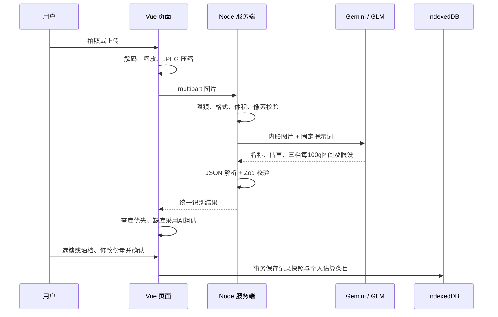

# 食刻开发教学：从一张照片到一条记录

## 1. 为什么把程序分成三部分

`packages/web` 负责页面、图片压缩和浏览器本地存储；`packages/server` 负责持有密钥、校验上传及调用模型；`packages/shared` 负责共同的数据结构、营养库与计算规则。

TypeScript 在开发时检查类型，但无法保证外部模型真的返回正确数据。因此共享层还用 Zod 在运行时校验 JSON。前后端遵守同一份业务结构，供应商接口差异留在后端适配器内部。

## 2. 图片如何进入 AI

浏览器使用 `FormData`，不用自己把图片转换成一个巨大的 JSON 请求。压缩既减少上传时间，也减少模型的图片处理负担。预览用的 Object URL 在关闭后回收，照片不会进入饮食记录的备份。

模型现在同时输出名称、可见成分、估计重量，以及可选的每 100 g 营养粗估和假设。前端先匹配可靠基础库／参考配方，再考虑已确认个人条目与本次 AI 粗估。计算热量时使用每 100 g 数据乘以可食重量：例如一份依据为每 100 g 100 kcal、本次 150 g，便得到约 150 kcal。这里是公式例子，不对应任何具体食物。不能把整份热量当作每 100 g 数值，否则改重量后会错算。

新粗估使用三个情景的营养区间。默认选择 `medium`，再把每个字段的 `(min + max) / 2` 作为记账数值；换档时重新取中值，换重量时把区间端点与中值同比缩放。参考粥普通档 60～90 kcal/100 g、份量 300 g，区间为 180～270 kcal，记账 225 kcal。三个档位是配方条件的参考假设，不是经过统计验证的置信区间。食品营养会因原料、加工等因素变化，USDA 也说明了数据的变异性；该说明并不为应用的具体情景区间背书。[USDA 数据变异性说明](https://fdc.nal.usda.gov/Foundation_Foods_Documentation/)

用户手填确定的营养数值时，这一条撤销情景区间，按用户输入计算；不会同时加上模型中值。参考配方的油档以非油配料为基底，替换原来的油量，避免重复计油。历史记录保留当时的档位和范围快照；新拍的一餐默认回到普通档，不把上次的甜度或用油自动套用到新照片。

旧个人估算只有单值时，新的有效三档可以替代它作为这次编辑的依据。确认保存才更新同一个库条目；历史记录继续保留旧单值，不会被自动改成新中值。如果本次没有可用热量区间，也不会为了升级而丢掉旧的已知值。

界面称为“计算依据”，因为它说明当前数值来自数据库、配方、AI 或手工填写，并不代表食物里的营养成分来源。“AI 估算”必须继续显示为估算，即使已保存到个人库。

纠正食物名称后，页面重新匹配这个名称的计算依据。原来针对另一种食物的 AI 粗估不能按新名字入库；没有新匹配时清空旧依据，提示补充营养或重新识别。只改空白等不改变含义的写法会保留当前数值，明确手工填写的数据也会保留。

## 3. 模型切换为什么不用改页面

页面调用的是食刻的 `/api/recognitions`，而不是 Google 或智谱的地址。两个适配器都返回统一的 `RecognitionResult`。更换 `AI_PROVIDER` 并重启服务即可切换供应商。

`AI_MODE` 决定使用真实服务还是 Mock。Mock 也走上传、校验、确认和本地保存流程，适合没有密钥时测试 UI；它不是真正读取照片里的食物，界面和记录必须持续标注模拟。

具体请求体、鉴权、响应提取和错误排查见 [AI 调用教学](ai-models.md)。

## 4. 为什么不能把空数据当成 0

`null` 表示不知道，`0` 表示数据源明确测得或记载为零。未知重量、没有匹配的菜、缺少营养字段都会让相应汇总不完整。页面显示“已知部分估算”，而不是给出一个看起来精确、实际偏低的总量。

配方只负责把已有基础食物组合起来。用油量是明确的参考假设，用户可以修改；图片中的熟食重量不能直接套生食数据。历史记录保存计算时的数据快照，后续营养库更新不会改变你之前的摄入。

## 5. IndexedDB 保存了什么

饮食记录保存日期、餐次、食物列表、营养及依据快照、模拟／真实／手动标识和时间戳。体重按日期保存，设置保存目标体重。新增个人估算表保存确认过的 AI 条目，和 USDA 基础库独立；照片和 API Key 不参与本地持久化。

事务将一组写操作作为整体提交。餐食记录与新个人估算条目同时提交，只有提交成功后才提示“已保存”；取消或失败不会写入个人库。Mock 条目只用于模拟记录，不加入真实个人估算库。恢复备份先校验再替换，并通过事务保证失败时原数据仍存在；v1 文件会自动转换为包含空估算库的 v2 结构。

IndexedDB 按网站来源隔离，不提供跨设备同步。关闭已打开的页面后，离线重新加载还需要缓存页面资源；第一版本身不是离线 PWA。

## 6. 如何验证修改

先运行 `npm run typecheck`，检查 Vue 与 TypeScript 类型；再运行 `npm test`，验证营养、结构校验、错误路径和存储；运行 `npm run build` 检查生产构建；最后运行 `npm run test:e2e` 走真实浏览器操作。

自动化测试使用 Mock，避免消耗 API 额度。真实模型测试应单独进行，并把“接口可用”和“餐食判断正确”分开：需要人工标注的食物名称、真实称重，以及多次重复测试，才能比较模型误判和重量误差。

## 7. 建议的学习顺序

1. 阅读 `shared` 的结构与营养计算，理解 `null` 和数据快照。
2. 阅读前端图片处理及 API 请求，理解 FormData 和异步状态。
3. 阅读后端上传校验和 VisionService，理解密钥隔离及适配器。
4. 阅读存储和备份，理解事务及导入验证。
5. 修改一个小功能并执行以上验证命令。

关键代码中的中文注释解释设计原因与容易出错的边界；组件、函数和变量名称说明日常实现，不逐行重复代码本身。
