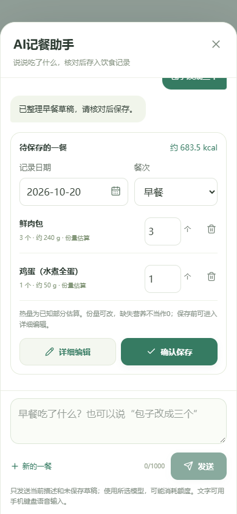

# 文字记餐助手与常见份量教学

0.10.0-test新增悬浮“AI记餐”入口；按本次需求先支持文字，手机可使用系统键盘的语音输入，不请求应用内录音权限。

## 怎么使用

1. 点击右下角“AI记餐”。在窗口内可选择当前已配置的模型，沿用照片识别的多Key配置，不自动切模型。
2. 输入“早餐吃了两个肉包和一个鸡蛋”，点击发送；也可以写“午饭米饭150g，番茄炒蛋一份”。日期和餐次会整理成草稿，可以手动修改。
3. 没说份量时，应用补可修改的常见份量。可以继续发“包子改成三个”“再加一根香蕉”“去掉鸡蛋”，助手根据当前未保存草稿返回完整修改结果。无关追问保留草稿，明确取消整餐才清空。
4. 预览中可修改数量、移除食物；需要换食品库、改每100g营养或核对包装时，点击“详细编辑”，转到现有餐食编辑面板。
5. 点击“确认保存”才写入IndexedDB。重复点击不会创建多条。成功后清掉待提交草稿；再描述食物会建立新记录，避免把上次早餐重复记账。

关闭悬浮窗再打开，同次运行中的聊天和草稿还在；刷新或退出会清掉聊天草稿，已经保存的饮食记录保留。聊天内容不加入饮食备份，导出仍只包含记录、设置和食品快照。

## 按时间预选餐次

0.10.1-test起，未说明餐次时，使用手机／电脑本地时间作为默认建议：

- 05:00（含）至11:00（不含）：早餐。
- 11:00（含）至15:00（不含）：午餐。
- 17:00（含）至22:00（不含）：晚餐。
- 其余时段：加餐，包括15:00–17:00和22:00–次日05:00。

这是产品的初始时段划分，不是对个人作息的判断，也不代表用餐建议。可在相机、编辑器或助手预览中改餐次。点击早餐／午餐等分组中的加号时，直接采用该组餐次。

首页的“拍照识别”“添加食物”、顶部／底部拍照快捷入口在每次打开时重新读取时间。AI助手在新一餐首次发送时读取时间，再把建议的mealType发给模型；例如晚上输入“吃了两个包子”，默认晚餐，明确写“早餐两个包子”则以早餐为准。模型得到的是明确餐次上下文，不靠猜包子通常在哪餐吃。

已有草稿的餐次优先，包括手动修改；跨中午、深夜、关闭重开助手都不会擅自更换。点击“新的一餐”或保存后再次描述时重新判断。补记历史时保留页面所选日期；编辑旧记录保留原餐次，不用保存时间重新归类。

实现见`packages/web/src/lib/dates.ts`的`suggestedMealType`，使用`Date.getHours()`读取设备本地小时，不使用UTC或服务端时区。调用点是`App.vue`、`DiaryView.vue`的点击事件，以及`MealAssistant.vue`首次发送。共享`ASSISTANT_PROMPT`明确餐次优先级：本次文字指定 → 旧草稿 → 请求默认值。时段只影响初始值，不修改数据库结构或历史快照，不增加AI请求次数。

## 缺重量时怎样填

模型仍可诚实返回“照片无法估重”。应用在第一次生成记录草稿时，用不同食物的参考份量补空值，并保存“常见份量估算”说明，不能把它标成照片测量或模型看出的重量。

例如：肉包／菜包／馒头参考1个80g，鸡蛋1个可食部分50g，米饭1小碗150g，粥1碗300g，切片吐司1片25g，香蕉1根可食部分100g，家常炒饭等混合菜1份250g。未分类食物暂按1份200g；可匹配的肉类、蔬菜、坚果等还有分类参考。完整规则见`packages/shared/src/portions.ts`的`typicalPortion`。

**这些是产品的可修改份量假设，不是营养数据库实测值、人群平均饭量或膳食建议。** 大小、食材、个人习惯差异很大，用户可直接改g或切换“个／碗／份”调整。明确的重量和0不覆盖；用户后来主动清空的字段不会反复强填。旧餐食不会因新规则被重新估重。

拍照、从食品库新选食物、手动填写名称时均可补初始空份量。手动录入重量时优先让用户输入，避免补值和键盘输入拼接。包装只在计量基准明确时参考一份g或mL，**不把包装净含量当实际摄入量**；基准未读清仍提示补充，不擅自判断单位。

## 热量如何计算

文字模型只解析食物名称、数量、单位、日期、餐次和对话意图，不直接报营养数。应用查本地基础食品、参考配方、个人食物及可精确匹配的包装食品，复用已有计算逻辑，保存当时的快照。

没有对应食物时可以先记参考份量，营养继续显示“待补充”，不是0；可去详细编辑选相近食品或手填确定值。明确描述mL时，缺少对应每100mL营养就保留缺失，不能直接把每100g数据换成容量、假定密度为1。一般“1杯牛奶”的克数是明确标注的份量参考；“250mL牛奶”则按容量保留。

## 怎么调用AI

共享契约在`packages/shared/src/meal-assistant.ts`：

```ts
// 只传本次文字和未保存的同一餐草稿，不附带其它饮食记录或个人资料。
const request = {
  text: '包子改成三个',
  date: '2026-10-20',
  mealType: 'breakfast',
  previous: currentDraft,
};
```

模型返回`intent`（update更新／question追问／clear清空）、日期、餐次、foods数组和简短回复。food仅有name、amount、unit，未说份量为null。每次最多10项、一餐；输入最多1000字，不允许任意工具、URL、API Key或提示词字段。多餐输入要求拆分，不静默漏掉。JSON及Zod校验不通过时保留输入和原草稿。

手机预览示例（测试数据）：



普通网页请求`POST /api/meal-assistant`，服务端选择已配置模型，使用固定端点与提示词。该接口与拍照共享鉴权、分钟限制、并发和日限额，不能借聊天绕过保护。Node适配器为`packages/server/src/meal-assistant.ts`。

安卓走Capacitor插件的`describeMeal`，Key沿用Keystore配合AES-GCM的本机加密配置。原生层只向白名单平台发送请求，不向网页返回Key；同样共用请求计数、单并发、超时、响应大小限制和禁止重定向策略。普通平台用Chat Completions JSON Object；Gemini用Interactions、结构化输出及`store:false`；不发照片，不创建上传文件，不自动轮换Key或转付费模型。模型费用仍以所选服务商为准。

服务商会收到当前描述和未保存草稿，应按其政策处理；App不把聊天写入本地记录数据库或备份。Vue以纯文本显示模型回复，不执行模型返回的HTML、脚本或工具指令。保存动作始终由用户按钮触发。

没有Key时网页可测试明确标注的Mock示例。Mock只演示少数常见食物和固定份量，不代表真实AI理解，不应拿模拟记录做真实饮食判断。

## 本轮验证

2026-10-21（0.10.1-test）：382项单元／接口测试通过，包括12个餐次时段边界及长时间打开页面的重新判断；类型检查、H5和独立APK构建、签名验证通过。36项Chrome手机／桌面、Edge回归覆盖按发送时间预选、手选草稿跨时段保留、下一餐重算、明确描述覆盖、相机餐次交接，以及历史日期与餐次保留。实际APK解包资源禁外网、模拟原生桥测试18项通过；3项只适用H5后端的Mock用例跳过。下载文件校验值与本地APK一致，沿用0.10.0签名；没有新增真实模型调用或Android真机测试。

2026-10-20：368项单元／接口测试、类型检查与生产构建通过；42项Chrome手机／桌面、Edge回归通过，最终助手调整后12项专项复测通过。APK构建、4项原生策略测试及验签通过；实际APK解包资源屏蔽外网并使用模拟原生桥，通过9项助手测试，另3项仅适用H5的Mock后端场景跳过。下载文件与本地APK校验值一致，沿用旧版签名。

本机已配置的Qwen3.7-Flash真实文字请求HTTP200，约1.96秒，合法返回肉包与鸡蛋两项草稿。肉包数量2已提取，鸡蛋数量没有提取，应用会显示常见1个的参考份量，仍需核对；这次调用不证明普遍的语言理解、称重或营养准确率。测试使用虚构早餐，不写入用户记录；Android真机上的文字网络与交互仍待验收。脱敏结果位于忽略目录`artifacts/android/assistant-live-check.json`与`meal-assistant-verification.json`。

网页版在3001提供已构建页面，5180仍可用于开发热更新；建议沿用原来的浏览器地址，保持同一份本地记录。构建APK时会分别更新H5与独立App产物。
