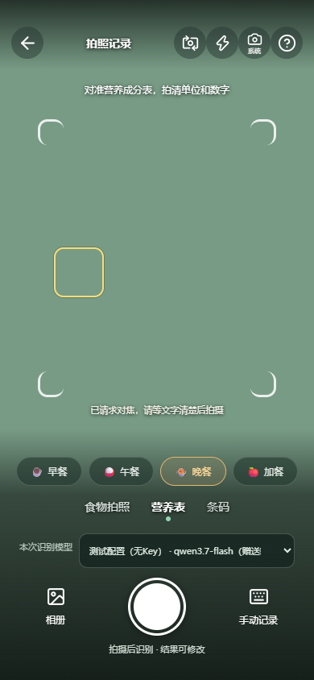

# 安卓相机模糊：原因、修复和真机验证

核对日期：2026-10-19。用户反馈机型为OPPO Find X9：食刻0.9.0-test的实时画面模糊，相同距离的系统相机清楚。

## 0.11.2取景窗口铺满

2026-10-23调整的是预览布局：之前虽然整个取景页覆盖窗口，预览仍被顶部与底部操作栏挤在中间；现在原生CameraX与网页video均使用整个应用窗口，操作层以半透明渐变浮在画面上。去掉桌面560px的取景页宽度上限，横屏时操作移到右侧，320px小屏采用紧凑按钮。系统相机入口移至右上角带「系统」小字的图标。

安全区仅为操作按钮留白，不再缩小预览或在取景页内画实色上下条。原生start与resize接收实际铺满后的CSS坐标，明确`includeSafeAreaInsets:false`避免重复叠加偏移；旋转与模型行高度变化由ResizeObserver同步。网页仍按object-fit:cover裁切拍摄，原生插件沿用共享ViewPort裁切；画面按比例覆盖，不做拉伸。图像边缘会随屏幕宽高比裁掉一部分，拍摄时将餐食放在中央可见区域。

这里的铺满范围是应用可用窗口，系统栏由Android窗口配置决定。本轮未改变Activity的系统栏策略，也未增加相机权限或依赖；屏幕覆盖与点击命中由浏览器桥模拟验证，OPPO实机画质、刘海与系统栏效果仍需手机验收。

## 已确认和未确认的区别

已确认旧APK使用WebView的`getUserMedia()`显示视频，拍摄时用Canvas截视频帧。虽然请求了高清尺寸，但`ideal`不是实际分辨率保证；连续对焦也只有浏览器明确报告支持时才设置，不支持时跳过。因此“请求高清”和“真实硬件对焦正常”并不等价。

截图中界面文字清楚、实景虚焦，符合焦点或镜头接入异常的表现，但截图没有镜头ID、实际视频尺寸、焦距或AF状态，不能确定唯一原因。没有把问题归因于镜头脏、手机性能或AI模型；模糊已经发生在上传与AI识别之前。

## 0.9.1-test如何修改

APK新增`@capgo/camera-preview@8.12.5`原生适配器，Android侧使用CameraX。网页仍保留原来的浏览器相机路径。

- 默认优先逻辑后摄的标准视角，切换按钮只在标准后摄和前摄间选择；不轮询物理微距、超广角或长焦镜头。厂商决定实际可用镜头，不能保证传感器型号。
- 原生Preview在WebView下方，原有HTML仍显示餐次、食物／营养表／条码和模型选择。只在原生取景期间挖空背景；退出立即恢复页面。
- 进入时请求中心对焦；点击包装文字后调用原生`setFocus({x,y})`。对焦框表示已发出请求，不伪装硬件已成功锁焦。
- 快门改为CameraX的静态照片输出，不截视频帧。传感器拍照目标上限3264×2448；这是请求目标，具体尺寸取决于设备和当前取景裁切。之后仍沿用应用的内存压缩、AI识别、编辑和记录流程。
- 系统相机按钮一直可见，实时预览仍模糊时可直接换用系统相机。切换前释放当前相机会话；取消后可点击继续拍摄。
- start／stop／capture串行，权限迟到时如果页面已关闭，就不再启动摄像头；已启动的会话退出、切后台时释放。

这里使用的是独立开源相机插件，不接入Capgo云端、计费服务或更新服务。第三方许可与源码见[声明](../THIRD_PARTY_NOTICES.md)。原生接口及CameraX实现可在[插件源码](https://github.com/Cap-go/capacitor-camera-preview)核对；浏览器对焦接口见[W3C Image Capture规范](https://www.w3.org/TR/image-capture/)。

## 隐私与存储

原生拍摄使用`storeToFile:false`、`saveToGallery:false`，照片经内存JPEG返回；不写入相册或饮食备份。明确关闭录音、定位、时间及位置水印。应用Manifest合并时移除录音、定位和广泛存储权限；条码仍使用既有ZXing，不启用新增插件的MLKit自动模型下载。拍食物和营养表后的图片只交给用户选定的AI模型。

## 代码路径

- `packages/web/src/lib/native-camera.ts`：平台探测、镜头选择、会话排队、取消、点按对焦、原生照片转内存File。
- `packages/web/src/components/CaptureCamera.vue`：选择原生／网页路径、预览大小同步、背景恢复、对焦点击和系统相机入口。
- `packages/web/src/lib/camera.ts`：浏览器Canvas裁切及点击坐标换算，避免cover裁切后焦点偏移。
- `packages/web/tests/native-camera.test.ts`：原生参数、权限迟到、启动中退出、清理和JPEG边界。
- `tests/e2e/native-camera.spec.ts`：原生桥模拟，验证原生路径不调用WebView取流、类型餐次不误触对焦、退出恢复背景、照片接入编辑流程。

## OPPO Find X9怎么复测

先在旧版导出JSON备份，然后覆盖安装0.9.1-test，勿先卸载。打开拍照，对准同一包装：

1. 保持与系统相机相同的距离和光线，点击营养表文字，等画面稳定。
2. 在问号中检查是否显示“原生CameraX”，并核对镜头名称；如果仍显示视频分辨率，说明没有进入新原生路径。
3. 拍下后点击照片缩略图查看大图，对比预览与结果。若只有结果不清晰，需进一步检查压缩；若预览就虚焦，继续检查实际镜头与AF兼容性。
4. 点“系统相机”拍同一包装作对照；记录新包版本、原生／系统相机是否清楚。

自动化只验证调用、会话、界面和照片流转；合成视频及模拟原生桥不能证明Find X9的真实对焦效果。仍需上述真机对照。

## 已执行验证

274项单元／接口测试、类型检查与生产构建通过。原有15项网页相机场景通过；9项原生桥场景修正模拟模型响应后通过，覆盖手机视口、Chrome和Edge桌面。另直接用最终APK解包资源重跑9项原生场景，网络被测试拦截，不调用真实模型。

安卓应用测试、APK编译与验签通过；核对原生CameraPreview插件和许可文件确实打包，新旧APK签名相同，可覆盖安装。成品Manifest含相机、网络及应用内部接收器权限，没有录音、定位或广泛存储权限。食品库1,055款、运动32项及离线保存也从APK资源复测。具体校验数据位于忽略的`artifacts/android/`目录。

