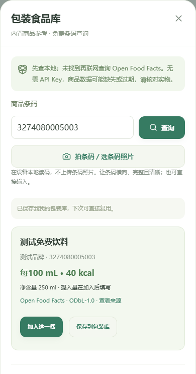

# 食刻如何调用 Open Food Facts API

本文对照当前实现说明接入流程，核验日期：2026-10-16。

Open Food Facts（下文简称 OFF）在食刻中提供**包装食品公开参考及条码查询资料**。它不是食物照片识别模型，也不负责推测你吃了多少。条码照片先在设备本地解码；只有条码数字会用于商品查询。拍营养表则仍由你选择的 AI 模型读取，两个流程独立。

当前另内置1,055款取得于2026-10-16的公开商品快照，可在「选择食物 → 包装食品」按10类搜索和离线选用，无需先保存个人标签。本次扩库使用官方Search-a-licious API分页取得公开搜索结果并程序筛选；未逐件核对实物，也不是完整国内商品库。分类、个人标签优先规则、来源文件和生成方法见 [运动与包装食品扩充教学](catalog-expansion.md)。

OFF 只读查询不需要 API Key；本项目没有接入收费条码服务。AI 是否收费取决于所选模型及你的账户，不受这个免费数据库的影响。[官方接入说明](https://openfoodfacts.github.io/openfoodfacts-server/api/)

## 0. 商品覆盖与本次实测

OFF是社区贡献的包装商品库，包含饮料、乳制品、零食、谷物等商品的品牌、条码、标签营养及配料资料，字段可能缺失；它并不是中国市场的完整商品目录。官方文档示例包含Nutella等产品，实际收录可在[公开商品网站](https://world.openfoodfacts.org/)浏览。不能由样本推算国内覆盖率，也不应把同类牛奶的值冒充某个条码的实测标签。

2026-10-16在同一环境对生产API进行3次只读查询，分别间隔至少4秒：官方示例`3274080005003`返回HTTP200及`status: "success"`；用户提供的`6978415301743`（超盒算牛奶）与`6979119680165`均返回HTTP404、`status: "failure"`、`errors[].message.id: "product_not_found"`。两个用户条码的校验位有效。因此本次是明确未收录，不是前端将网络故障报成没有商品；这不保证未来仍未收录。

当前实现仅把明确的`product_not_found`或旧版`status: 0`视为未收录。空响应、HTML404、无效JSON、其他错误ID都显示查询失败，避免误导。可切换「营养表」拍清包装标签，核对后保存到本机；保存过的商品会出现在统一「选择食物」的「包装食品」分类，可按名称、品牌和条码搜索。公开查询仍由用户触发，不批量抓库。

## 1. 从用户操作到 API 请求

在饮食记录面板点「包装食品库」，输入条码或选择条码照片：

1. 照片由 `readBarcode()` 使用 ZXing 在设备本地读取，支持 EAN-13、EAN-8、UPC-A；输入数字则跳过读图。
2. `barcodeSchema` 检查条码长度和 GS1 末位校验码，用字符串保存；数字输入另支持 14 位 GTIN。再按 OFF 规则统一补零形式，例如 UPC `034000470693` 对应 EAN `0034000470693`。这样相同商品不会因扫码设备补零方式不同而重复入库，也不会被误判为上游条码不符。[官方归一化规则](https://openfoodfacts.github.io/openfoodfacts-server/api/ref-barcode-normalization/)
3. 先在本机 IndexedDB 的 `packagedFoods` 表查找相同条码，再查内置1,055款公开商品参考。命中任一项就直接使用，离线也能工作；同条码优先采用个人保存的标签。
4. 两者均未找到时，用户提交一次明确的联网查询。不会每输入一个数字就请求网络。
5. 展示名称、品牌、规格、标签营养和来源链接。用户可以「加入这一餐」，也可以显式「保存到包装库」。这两个动作分开。
6. 加入餐食后，**实际摄入量保持未填写**。净含量只是包装规格，不能当成全部吃完。

页面代码：[PackagedLibrary.vue](../packages/web/src/components/PackagedLibrary.vue)；读码代码：[barcode.ts](../packages/web/src/lib/barcode.ts)；校验代码：[barcode.ts](../packages/shared/src/barcode.ts)。

以下截图使用构造的测试商品资料，展示查询与保存入口，不代表该条码的真实商品：



## 2. 网页和 Android 分别怎么请求

### 本机网页

```text
Vue 包装食品库
  → lookupProduct(barcode)
  → GET /api/packaged-foods/:barcode（同源本机 Node 服务）
  → lookupPackagedFood(barcode)
  → OFF HTTPS API
  → parseOffProduct() + Zod 校验
  → { product: 商品对象或 null }
```

网页不在浏览器里伪装 `User-Agent`，由 Node 服务设置请求头。开发时 Vite 把 `/api` 转发给本机后端；运行 `npm run dev` 会启动这两部分。这条路径需要本机 Node 服务，和独立 APK 的请求方式不同。

相关代码：[网页适配器](../packages/web/src/lib/food-catalog.ts)、[Fastify 路由](../packages/server/src/app.ts)、[Node 查询服务](../packages/server/src/food-catalog.ts)。

### 独立 Android APK

```text
Vue 包装食品库
  → lookupProduct(barcode)
  → Capacitor FoodCatalog.lookup({ barcode })
  → Android HttpsURLConnection
  → OFF HTTPS API
  → 返回 JSON 字符串给网页层
  → parseOffProduct() + Zod 校验
```

原生插件处理 HTTPS 请求，避免 WebView 跨域请求和浏览器请求头限制。手机可以直接访问 OFF，不需要电脑、自建服务器或同一 Wi-Fi；第一次查询仍然需要手机联网，而且实际连通性取决于手机网络。保存过的本地条目无需联网。

相关代码：[FoodCatalogPlugin.java](../packages/web/android/app/src/main/java/cn/anxiu29/shike/FoodCatalogPlugin.java)、[插件注册](../packages/web/android/app/src/main/java/cn/anxiu29/shike/MainActivity.java)。插件只允许固定 OFF 域名和条码参数，不能让页面传任意网址。

## 3. 实际请求地址和参数

当前代码采用官方文档列出的 v3.6 商品读取接口。版本和限制可能变化，以官方文档为准。

```http
GET https://world.openfoodfacts.org/api/v3.6/product/3274080005003.json?fields=code,product_name,product_name_zh,brands,product_quantity,product_quantity_unit,quantity,serving_size,serving_quantity,serving_quantity_unit,nutrition_data_per,nutriments
Accept: application/json
User-Agent: Shike/0.7.0 (https://github.com/Anxiu29/shike)
```

这里的 `3274080005003` 是官方文档的公开示例条码。实际使用时换成用户输入的条码。`fields` 只取需要的字段，减少流量；本项目不请求商品图片、用户资料或完整数据库。

- `code`：返回的商品条码，用于和请求条码核对。
- `product_name_zh`、`product_name`、`brands`：优先中文名称，其次通用名称，并保留品牌。
- `product_quantity`、`product_quantity_unit`、`quantity`：解析净含量。
- `serving_quantity`、`serving_quantity_unit`、`serving_size`：解析每份大小。
- `nutriments`：能量、蛋白质、脂肪、碳水等数值。
- `nutrition_data_per`：所请求的标签背景字段；当前计算使用标准化的 `*_100g`，不会再按它重复缩放。

请求地址由共享函数 `offProductUrl()` 生成，集中定义 `OFF_FIELDS`；Android 插件有对应常量，修改时需要同步两处。[共享解析与 URL 构造](../packages/shared/src/food-catalog.ts)

## 4. 用 Node.js 亲手测试一次

下面示例使用 Node.js 24 自带的 `fetch`，访问官方**测试环境**，可保存为临时 `.mjs` 后执行。测试环境的公开 Basic 凭据 `off:off` 由官方提供，不是食刻用户的账号，也不是需要申请的 API Key。日常使用的生产环境没有这段 Basic 请求头。[测试环境说明](https://openfoodfacts.github.io/openfoodfacts-server/api/#api-deployments)

```js
// 公开测试条码；仅演示一次只读请求，不循环抓库。
const barcode = '3274080005003';
const fields = 'code,product_name,product_name_zh,brands,quantity,nutriments';
const url = new URL(`https://world.openfoodfacts.net/api/v3.6/product/${barcode}.json`);
url.searchParams.set('fields', fields);

const response = await fetch(url, {
  headers: {
    Accept: 'application/json',
    'User-Agent': 'Shike/0.7.0 (https://github.com/Anxiu29/shike)',
    Authorization: `Basic ${Buffer.from('off:off').toString('base64')}`,
  },
  signal: AbortSignal.timeout(8000),
  redirect: 'error',
});
const data = await response.json(); // HTML、空响应等不能当成未收录。
const notFound = data.status === 0 || data.errors?.some(e => e.message?.id === 'product_not_found');
if (notFound) {
  console.log('OFF尚未收录此条码');
} else if (!response.ok) {
  throw new Error(`查询失败：HTTP ${response.status}`);
} else {
  if (!data.product) throw new Error('商品结构无效');
  console.log(data.product?.product_name ?? '缺少商品名称');
  console.log(data.product?.nutriments ?? {});
}
```

这只是教学示例。项目实际还会校验条码、限制响应大小、验证数据结构并返回中文错误，不会直接把任意上游 JSON 写进本地库。

开发环境已进行一次真实的官方测试环境查询，返回 HTTP 200，商品解析通过，识别出的基准为 `100ml`。它只说明该请求当时可用，不能代表国内商品覆盖率、手机网络可达性或资料准确率。

## 5. 返回 JSON 如何变成食刻的数据

下面是**用于解释字段的虚构示例**，不是上述条码的真实商品数据：

```json
{
  "status": 1,
  "product": {
    "code": "3274080005003",
    "product_name_zh": "教学示例饮料",
    "brands": "示例品牌",
    "quantity": "250 ml",
    "nutriments": {
      "energy-kj_100g": 250,
      "proteins_100g": 1.2,
      "fat_100g": 0,
      "carbohydrates_100g": 12.5
    }
  }
}
```

`parseOffProduct()` 负责把外部对象转成内部 `PackagedFood`：

1. 未找到商品返回 `null`；条码不一致或缺少名称则拒绝使用。
2. 标准化能量优先取 `energy-kcal_100g`，缺少时取 `energy-kj_100g`，再考虑标准能量字段 `energy_100g`（kJ）。不拿任意原始 `*_value` 或营养素参考值百分比 NRV 计算。
3. 三大营养素取 `proteins_100g`、`fat_100g`、`carbohydrates_100g`，按标准化的 g 保存。`null` 表示未知，明确的 `0` 才是零；不根据其他营养素补造热量。
4. OFF 的 `_100g` 字段也用于每 100 mL 的资料。当前解析器依赖明确的净含量／份量单位判断 `100g` 或 `100ml`；缺少单位或质量、体积互相矛盾时，基准设为 `unknown`，要求用户确认。这是保守规则，仍需核对实物标签。
5. 只识别明确的 g／mL，以及可直接换算的 kg／L 文本。不猜「一杯」「一片」的大小，也不把「6×30 g」猜成某个净重。
6. 不读取 `*_prepared_*` 冲调后数值，不把粉末、冲调饮品、每份与每 100 g 混在一起。
7. Zod 再检查数值上下限、来源 URL、条码和日期。无效对象不会进入包装库。

标准化字段及冲调字段的含义可对照 [OFF 营养字段文档](https://openfoodfacts.github.io/documentation/docs/Product-Opener/schemas/schemas/product_nutrition/)。如果 OFF 只提供一部分字段，食刻也只展示已知部分。

### 从每 100 mL 换算到实际喝下的量

以上虚构饮料的净含量为 250 mL，标签是每 100 mL 250 kJ。用户明确选择「半包」后：

```text
实际体积 = 250 × 0.5 = 125 mL
摄入能量 = 250 ÷ 4.184 × 125 ÷ 100 ≈ 74.69 kcal
```

显示最多两位小数；内部计算保留精度。125 mL 不会变成 125 g，没有密度时不做质量和体积互换。具体换算函数见 [package-label.ts](../packages/shared/src/package-label.ts)。

## 6. 本地保存、历史记录和备份

点击「保存到包装库」后，保存名称、品牌、条码、标签以及来源信息到 IndexedDB，而非向 OFF 上传数据。相同条码需要确认覆盖；纯查看查询结果不会自动收录。

来源保留 `type: openfoodfacts`、原条码、商品 URL、`license: ODbL-1.0` 和查询时间 `retrievedAt`。查询时间表示「何时取到」，不是厂商最新配方的认证时间。手动改过标签会保留修改标记，不能冒充 OFF 原始数据；源条码不允许改成另一个商品。

当前缓存不会后台自动刷新。需要重新获取公开资料时，可以删除该包装库条目后再次查条码；也可以核对新包装，手动修正标签后确认覆盖。删除库条目不会删除历史餐食。

选用库条目时，为这一餐创建新的标签快照，实际摄入量重新填写。以后覆盖或删除包装库条目，已经保存的餐食不会随之变化。模拟标签不能加入真实包装库。

IndexedDB 新增 `packagedFoods` 表，包装库从v5加入备份；当前v6另支持普通饮品mL快照，兼容v1～v5。旧v1～v4备份迁移时包装库为空。导出、导入保留来源标记，恢复事务失败会回滚。API Key 不在记录备份中。[本地数据库实现](../packages/web/src/lib/db.ts)

## 7. 限流与失败处理

官方目前对商品读取设置每 IP 每分钟 15 次限制。食刻界面和 Android 插件要求查询至少间隔 4 秒，本机 Node 接口另限每 IP 每分钟 10 次。多台设备共用一个出口 IP 仍会共同占用 OFF 额度，四秒间隔不等于保证永远不被限流。[官方限流说明](https://openfoodfacts.github.io/openfoodfacts-server/api/#rate-limits)

Node 上游请求设置 8 秒超时；网页请求本机接口为 10 秒。Android 连接和读取各有 8 秒超时，两个阶段不能理解成严格的总耗时 8 秒。响应大小也设有上限，且禁止跳转到其他域名。

- `404` 或明确的未找到结果：提示「没有找到」，可改拍营养表或手动填写。
- `429`：提示稍后重试，不连续自动重发，也不自动调用收费 AI。
- 网络中断、超时、异常 JSON、结构不合法：保留已有本地记录和草稿，显示错误。
- 找到商品但营养不全：保留缺失值，要求用户补充；不显示成零热量。

当前没有接入 OFF 在线名称搜索或后台批量抓取。「搜名称、品牌或条码」只搜索自己保存的本地包装库。大规模扩库应另用官方数据导出方案，不能靠遍历条码请求实现。

## 8. 隐私、数据来源和许可

OFF 查询发送条码、应用标识和正常网络请求信息，服务自然能看到请求 IP；不发送条码照片、饮食历史、体重或模型 API Key。用户主动打开商品来源链接时，会在浏览器访问 OFF 网站。营养表 AI 识别是另外一条明确的模型请求。

OFF 数据库采用 ODbL，数据库单项内容和商品图片另有各自许可；它不是 USDA 的 CC0 数据。食刻目前不下载 OFF 商品图片。界面和备份保留来源及许可，不能把这批商品数据宣称成自己独占或不受限制的数据库。以后公开分发、合并或提供衍生数据库前，需要按官方条款核对署名与共享要求；分开存表不自动免除许可义务。[官方许可入口](https://openfoodfacts.github.io/openfoodfacts-server/api/#before-you-start) · [使用与再使用条款](https://world.openfoodfacts.org/terms-of-use)

官方还要求开发者告知 API 用途。项目未代你向第三方提交表单；公开发布前可由维护者填写官方文档中的 API usage form，并保持应用联系信息有效。

## 9. 怎么调试和继续扩展

本机安装后：

```sh
npm install
npm run dev
```

在页面打开包装食品库后，浏览器开发者工具的 Network 面板能看到 `/api/packaged-foods/条码`。Android 的上游 HTTPS 在原生插件中执行，不会全部出现在网页 Network 列表；调试时不要把 Key 或私人记录写进日志。

```sh
npm test
npm run build
npm run test:e2e
```

常规测试应使用构造数据或网络桩，避免大量消耗免费公共服务。需要验证真实连通性时，单独请求官方测试环境，不读取私人照片、不循环扫条码。

本轮单元／接口测试共 229 项通过。OFF 相关测试覆盖条码校验、本地 EAN-13 读图、固定域名请求、响应校验、kJ 与 mL、缺失值、来源一致性、限流、查不到不调用 AI、本地复用、历史快照与 v5 备份。Chrome 手机视口、Chrome 桌面、Edge 桌面及 LAN HTTP 均已验证新增流程；Android 原生 HTTPS 真实连通和相机拍摄仍需真机检查。

以后更换商品数据库时，主要增加类似 `lookupProduct()` 的适配器，并转换成相同 `PackagedFood`。不要把供应商 JSON 直接塞进餐食记录，也不要把商品查询失败自动变成一次收费模型调用。

更多操作说明：[包装识别与换算](packaged-food.md)、[AI 模型调用教学](ai-models.md)、[手机多模型配置](personal-models.md)、[项目 README](../README.md)。
