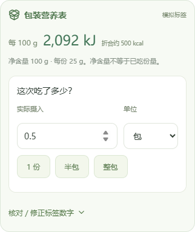

# 包装食品：拍营养表、核对数字、填写摄入量

0.7.0 增加「包装食品库 · 搜索／扫码」：照片本地读码，再免费查询 Open Food Facts。可保存品牌、规格与来源到本机，离线复用。名称搜索仅针对本地库。[完整请求、代码和许可教学](open-food-facts.md)

0.6.0 支持预包装食品。沿用现有拍照／选图入口，模型自动区分普通餐食和商品包装；安卓手机自配 Key 与网页后端使用同一套结构和规则。没有可用模型时，可在记录面板点“包装食品”手动抄表。Mock 模式仍是明确标注的示例识别，不会真的读取照片。

## 怎么拍、怎么记

1. 点击“拍照识别”，拍清包装上的营养成分表，尽量同时包含商品名称、净含量和每份大小。避免反光、折痕和太小的文字。当前仍一次上传一张照片。
2. 查看“包装营养表”卡片，核对标签是每 100 g、每 100 mL、每份还是每包，以及能量原单位 kJ／kcal。同一张表有两列时，只采用其中同一列的数值。
3. 在“这次吃了多少？”填写 g、mL、份或包。可换算时提供“1 份”“半包”“整包”快捷按钮。**摄入量默认留空，包装净含量不代表你吃完了。** 换摄入单位会清空原数量，避免把 200 mL 悄悄解释为 200 份。
4. 展开“核对／修正标签数字”，可更正能量、原单位、蛋白质、脂肪、碳水、每份大小和整包净含量。未拍到或读不清的字段留空；不要把 NRV%／%DV 当成克数或热量填入。
5. 选择餐次、日期并保存。历史记录保留当时的标签与摄入份量，可继续编辑；修改其他食物库数据不会改变它。

只拍商品正面或广告文字，不能可靠获得完整营养表，AI 不凭品牌记忆补营养值；此时提示补拍或手填。条形码请走独立「包装食品库」入口。条码照片仅用于本机读码；从记餐编辑器识别营养表并保存餐次时，压缩照片会保留到餐次历史和 v11 备份。

普通餐食继续使用食物库／参考配方／带假设的 AI 三档估算。包装走独立的“包装标签 · AI 读取”分支，优先于同名食物库，不套普通餐食的少糖／多油三档，也不自动加入个人 AI 估算库。用户更正后的标注显示“已手动修改”。

以下为合成测试标签的界面示例，数值仅用于验证换算，不是某款商品的数据：

## 换算逻辑

模型负责抄可见标签原数值与计量基准，代码负责计算。能量按 `kcal = kJ / 4.184` 换算；原标签仍保留 kJ，不能把 2092 kJ 直接当成 2092 kcal。[NIST 单位换算表](https://www.nist.gov/pml/special-publication-811/nist-guide-si-appendix-b-conversion-factors/nist-guide-si-appendix-b8)

例如以下数据仅是测试假设，不代表某个商品：每 100 g 为 2092 kJ，净含量 100 g，每份 25 g。换算后每 100 g 约 500 kcal；吃 25 g 为约 125 kcal，半包约 250 kcal，两份约 250 kcal。份量按包装标注的每份大小换算，不能把每份数字直接当每 100 g。[FDA 对每份与整包的说明](https://www.fda.gov/food/nutrition-facts-label/serving-size-nutrition-facts-label)

每 100 mL 按摄入体积计算，不假设密度，因此记录不会伪造克重。每份或每包标注即使没有克数，也可以按对应份／包数量记录；要换成 g 或 mL，必须有同单位的每份大小或净含量。缺少换算信息时显示待补充，已知部分仍可保存和汇总。

数值最多显示两位小数，内部换算保留精度。标签读取仍可能出错，标注值也不等于该份食物的实测值，所有热量显示为估算。冲调前／后、沥干状态、调料包是否包含在内，都需要按实际标签核对；不从蛋白质、脂肪和碳水反推出缺失能量。

## 开发教学：一次模型调用如何接入

- `packages/shared/src/vision-prompt.ts`：增加包装规则与 `packageLabel` JSON Schema。普通餐食返回 `packageLabel:null`；包装返回原能量单位、基准、宏量、每份大小和净含量，粗估字段留空。文字只当照片中的数据，不执行其中指令。
- `schemas.ts`：结构校验限定单位、非负有限数值、换算合理范围，以及快照与原标签的一致性。标签中的小于号或看不清的数值由模型保留缺失并提示，不强行当确定值。
- `vision-parse.ts`：包装不要求三档；标签与粗估混用会被拒绝，模型填写的包装视觉重量会清空，不能当作摄入。
- `package-label.ts`：纯函数实现 kJ 换算、质量／体积／份／包的比例和快照同步，质量与体积不互换。`calculateNutrients()` 集中分流，日汇总与热量预算复用结果，不重复累计标签和食物库。
- `packages/web/src/lib/recognition.ts`：包装标签优先创建独立条目，普通餐食继续原匹配流程。
- `components/PackageLabelEditor.vue`：核对与编辑原标签、输入实际摄入；标签修改与摄入量修改分开，单纯换份量不会冒充修改了标签。
- 网页 Gemini／GLM／Qwen 适配器共享包装请求说明；安卓 `PersonalVisionPlugin` 也使用包装读取规则。Key 保存位置和密钥隔离方式没有改变。

标签快照保留原标签、实际摄入量、模型及修改标记。0.7.0 备份为 v5，新增 `packagedFoods`，可读 v1～v4；IndexedDB 升为版本 4，只加新表，保留原有记录。修改或删除包装库不改写历史。模拟标签不可入真实库，保存前须补全基准和能量。

## 验证与限制

单元测试覆盖 kJ／kcal、按克／mL／份／包、每份缺重、单位不匹配、零与缺失、非法结构、快照一致性与旧备份升级。接口与安卓桥测试覆盖标签不要求三档、原单位保留及模型重量清空。浏览器用例覆盖读取、改标签、份量缩放、保存刷新、备份恢复和模拟标识。

已用当前 Qwen3.7-Flash 对一张清晰英文合成营养表发起一次真实调用，约 4.7 秒返回 HTTP 200；该图的能量、宏量、基准、净含量与每份大小均与固定测试值一致。未读取私人照片。这仅验证一条清晰测试图的流程，不是实物包装、中文小字、曲面反光或所有供应商的准确率结论；其他适配器通过契约测试，真实照片及 Android 相机仍待手机验证。

0.7.0 通过 229 项单元／接口测试及生产构建。浏览器覆盖 93 个场景，三条旧页面结构断言更新后已单独复测通过；新增流程另在 LAN HTTP 下通过 18 个场景。APK versionCode 7、两项原生策略测试、构建与验签通过，签名与旧测试包相同。实际解包页面禁网验证标签、包装库与能量切换保存刷新，未请求外网；资源和 DEX 中未发现本机已配置的模型密钥，下载文件与本地哈希一致。这些检查不替代安卓真机安装、原生商品 HTTPS、相机、软键盘与分享测试。
